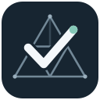
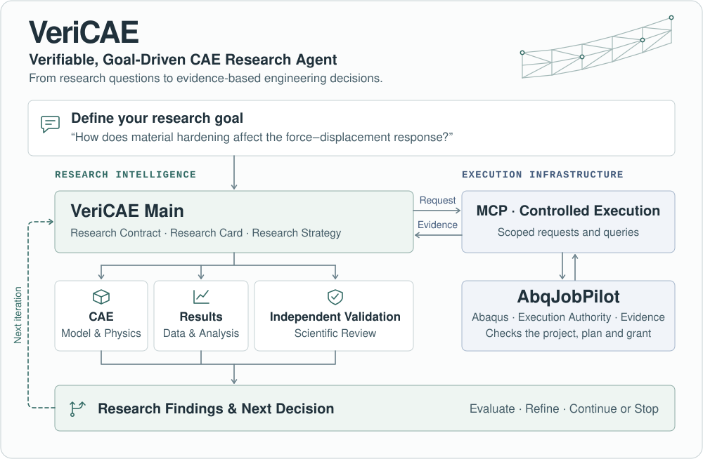
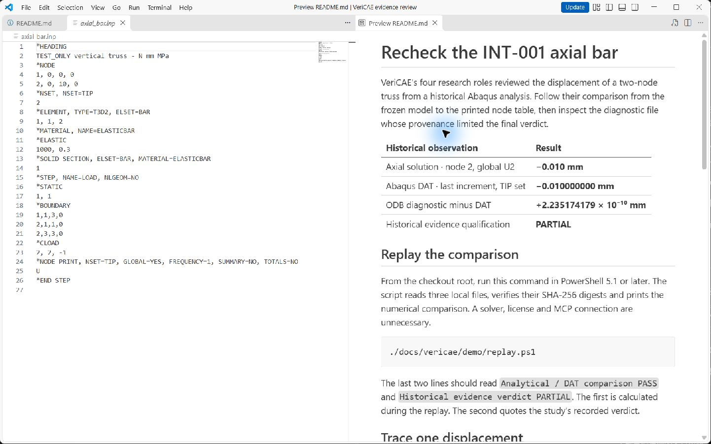

# VeriCAE

[简体中文](README.zh-CN.md) ·  · [Source code](product/vericae/) · [Apache-2.0](LICENSE)

## What is VeriCAE, and what can it do?

VeriCAE helps engineers plan and review computational studies in Codex. **Goal-Driven Research** starts with a question, a measurable quantity and a stopping condition. Initiate records them in a Research Contract and Research Card. The team checks a reference model, plans an experiment and independently reviews the evidence. The researcher can then decide what to investigate next.

<picture>
  <source media="(prefers-color-scheme: dark)" srcset="docs/assets/research-workflow-dark.svg">
  
</picture>

Conceptual research workflow illustration, not a screenshot of a completed end-to-end live solver run.

<table>
<tr>
<td width="50%" valign="top"><strong>01 · Inverse Identification</strong> Estimate material parameters from a specimen’s measured response. For example, compare small-punch test data with model predictions.</td>
<td width="50%" valign="top"><strong>02 · Simulation-Driven Scientific Discovery</strong> Test candidate scaling laws and dimensionless relationships against a series of mechanics simulations.</td>
</tr>
<tr>
<td valign="top"><strong>03 · Engineering Design &amp; Process Optimization</strong> Compare candidate process parameters or scan strategies under engineering constraints.</td>
<td valign="top"><strong>04 · Mechanism &amp; Sensitivity Investigation</strong> Vary loads, materials or geometry to identify which factors drive failure, distortion or a nonlinear response.</td>
</tr>
</table>

These examples illustrate the kinds of research VeriCAE is designed to plan, organize, and verify. They do not imply that all scenarios have already completed full live solver validation in v1.0.0.

## How is VeriCAE architected?

View the research and execution workflow

<picture>
  <source media="(prefers-color-scheme: dark)" srcset="docs/assets/research-workflow-dark.svg">
  
</picture>

**VeriCAE owns the research decisions.** Main is the sole writer of primary research state. It issues Task Cards to CAE, Results and Independent Validation, reads their replies and records the next decision. Research Cards, handoffs and reports live in project files. Codex supplies the conversations, so no separate VeriCAE runtime or database is required. [Technical architecture](ARCHITECTURE.md)

**AbqJobPilot is the controlled execution layer.** It checks a Plan and its Grant, supervises authorized jobs on Windows and returns execution records through MCP. A research agreement does not authorize a solver run. [Execution platform](https://github.com/BrunelXian/AbqJobPilot) · [Compatibility and verification scope](COMPATIBILITY.md)

### Real Research Evidence

*The public INT-001 replay workbench in VS Code. The input deck is on the left and the historical case data are on the right.*

**Numerical check · PASS.** At node 2, the analytical axial displacement and the historical Abaqus DAT table agree at **−0.010 mm**. **The overall evidence verdict was PARTIAL.** The original extraction receipt recorded a failure, and the historical record could not establish who produced the diagnostic output bytes. The public replay checks the arithmetic offline. Qualification of a fresh live solver run is a separate step. [Replay the comparison](docs/vericae/demo/README.md) · [Read the case findings](docs/vericae/INT-001.md)

## How do I install / get started?

1. Download the [plugin ZIP](https://github.com/BrunelXian/Goal-Driven-CAE-Orchestrator/releases/download/v1.0.0/VeriCAE-1.0.0.zip) and [SHA-256 checksum](https://github.com/BrunelXian/Goal-Driven-CAE-Orchestrator/releases/download/v1.0.0/VeriCAE-1.0.0.zip.sha256) from the [VeriCAE 1.0.0 release](https://github.com/BrunelXian/Goal-Driven-CAE-Orchestrator/releases/tag/v1.0.0). Follow the [installation guide](INSTALL.md) to verify the ZIP and register its extracted directory as a local Codex marketplace.
2. Open your research workspace in Codex Desktop and select **Initiate CAE Research**. Try *“Plan a cantilever tip-displacement study. Show me the observable, the reference model and the acceptance criteria before creating files.”*

Use **Conduct** to resume a study and **Setup** to check the tools available in your session. Planning and offline review work with VeriCAE alone. For controlled execution, see the [AbqJobPilot 1.0.0 Windows release](https://github.com/BrunelXian/AbqJobPilot/releases/tag/v1.0.0).

## Who built this?

Xian (BrunelXian) maintains VeriCAE and AbqJobPilot. VeriCAE’s Codex Native skills, role definitions and research templates are public in this repository. AbqJobPilot ships separately as a standalone Windows execution platform. [VeriCAE source](product/vericae/) · [AbqJobPilot source](https://github.com/BrunelXian/AbqJobPilot) · [Maintainer](https://github.com/BrunelXian)

## What is the future plan?

The research agenda asks when an agent has enough evidence to choose its next experiment. Proposed work beyond v1.0.0 includes qualifying fresh solver runs from authorization through output review, comparing experiment-selection strategies under a fixed budget, and testing which checks transfer across solvers and coupled physics. [Research agenda and proposed experiments](docs/vericae/RESEARCH-AGENDA.md) · [Development archive](docs/archive/README.md)
