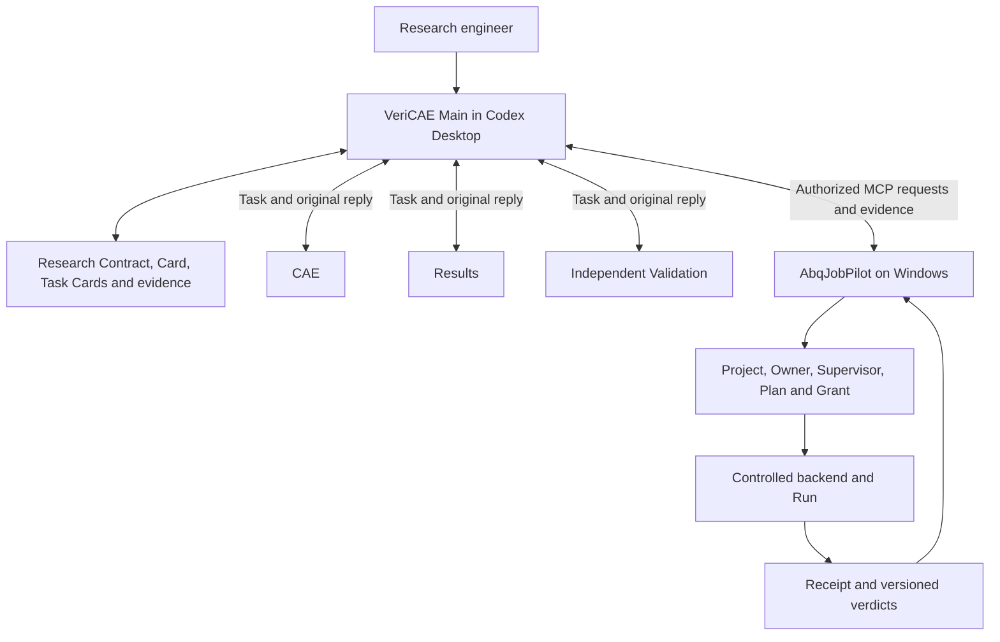

# VeriCAE · Agentic Research Framework for Computational Engineering

**Can an independent reviewer reconstruct a simulation claim from the model, the measured quantity and the execution record?** VeriCAE gives research engineers a way to ask that question before trusting a result. In the axial-bar study below, the analytical prediction agreed with the printed displacement and an independent reviewer reproduced the result. The historical extraction receipt still read `FAILED`.

**Research Preview · VeriCAE 0.5.6** is available from the public PR branch in the quick start. The companion execution platform is **AbqJobPilot 0.5.3 DEV**. The two products have separate version histories. This preview is a source snapshot for evaluation. The preview can be evaluated from source. This branch carries no stable-release designation or public marketplace listing.

## Where research ends and execution begins



VeriCAE owns scientific decisions. Research state lives in Markdown and YAML, and Codex supplies the persistent conversations and their communication. The plugin requires no separate agent runtime or task database. AbqJobPilot owns execution authorization, budgets, process supervision and provenance. A Task Card scopes research work. A Grant governs execution. [AbqJobPilot repository](https://github.com/BrunelXian/AbqJobPilot)

## How a study works

1. **Verified-Model-First.** Initiate turns a question into a Research Contract. Specify the observable, units, tolerance and stopping condition. The six-part Research Card records the simplest model that can test the claim and its qualification status.
2. **Goal-Driven.** Conduct resumes from the Handoff. **Main** writes the primary state and dispatches bounded Task Cards to existing conversations. **CAE** examines geometry, materials, loads and restraints and derives an expected response. **Results** checks the actual output selector, units and provenance.
3. **Verifiable.** **Independent Validation** challenges assumptions and recomputes the result. Main reads the original replies, links artifacts to tasks and records which conclusions survive review. Researchers can consult a role directly. [Task and return protocol](product/vericae/vericae-research/references/cross-thread-protocol.md)

## Quick start

With Git and a Codex installation that supports local plugin marketplaces, run these commands in PowerShell. Keep the checkout where the marketplace can continue to read it. The historical branch name is intentional.

```powershell
git clone --branch codex/vericae-0.5.5-public --single-branch https://github.com/BrunelXian/Goal-Driven-CAE-Orchestrator.git
cd Goal-Driven-CAE-Orchestrator
codex plugin marketplace add ./product/vericae
codex plugin add vericae-research --marketplace vericae-public --json
codex plugin list --marketplace vericae-public --json
```

Look for `vericae-research@vericae-public`, version `0.5.6`, with `installed` and `enabled` both true. In a Codex Desktop project, select **VeriCAE Research (Test)** and ask **Set Up Research Environment** to identify its three visible skill entries. Research planning works offline. Live execution or historical readback requires a separately provisioned AbqJobPilot connection.

Try Initiate with *“Plan a cantilever tip-displacement study. Show me the observable, reference model and six-part Research Card before creating any files.”* After confirming the draft and project directory, use Conduct to resume from `docs/initiation/HANDOFF.md`. [Workspace template](product/vericae/vericae-research/templates/research-project/README.md)

### Reproduce the axial-bar comparison in one minute

From the checkout root, run the public replay in PowerShell. It reads the frozen bar input and the published historical displacement observations. Abaqus and an MCP connection are unnecessary.

```powershell
./docs/vericae/demo/replay.ps1
```

Expected: analytical and printed DAT displacement **−0.010 mm**, absolute diagnostic difference **2.235174179 × 10⁻¹⁰ mm**. Repeating the arithmetic checks numerical agreement. Qualifying the historical extraction still requires evidence linking its producer to its output. [Replay inputs and method](docs/vericae/demo/README.md) · [Study findings](docs/vericae/INT-001.md)


*Preview workbench in VS Code: the frozen Abaqus input beside the public case notes and replay instructions.*

## Engineering evidence

| Study | Evidence | Decision |
|---|---|---|
| INT-001 · VeriCAE 0.5.5 + AbqJobPilot 0.5.3 DEV | Read-only review of a **historical real Abaqus** T3D2 run. MCP integration, four-role orchestration, scientific/numerical verification and independent validation each passed. | **PARTIAL overall.** The historical extraction receipt is `FAILED`. Execution and extraction qualifications are `REVIEW_REQUIRED`. Historical result data integrity is `INSUFFICIENT`. The ODB-derived value has diagnostic use only. |
| INT-002A.1 · separate execution-bridge test | Real MCP submission with an exact Grant and budget, a fake backend, terminal Run, SHA-256-bound test output, idempotent submission and reconnect recovery. 250 targeted regression checks passed. | **TEST_ONLY PASS**, `solver_conclusion=NOT_RUN`. General-purpose real execution remains **NOT_READY**. |
| INT-002B · separate planning exercise | Research Contract, Task Cards and acceptance criteria prepared. The execution owner became unavailable. | **Planning PASS. Execution BLOCKED / STOPPED.** Zero new submissions. Current Grant balance unknown. |

## Runtime limits and research directions

Version 0.5.6 adds a four-step MCP check in the project's active Desktop Main: verify registration, discover tools, make an authorized read, then validate the responding service and permission scope. If discovery fails, Setup diagnoses the environment. When a restart is needed, Main saves a checkpoint and the researcher resumes the original conversation. Host support governs thread visibility and effective model settings. [Runtime verification and recovery](product/vericae/vericae-research/references/mcp-runtime-verification.md)

The next engineering milestones are reproducible execution-environment binding and evidence-qualified fresh solves. The research questions are how to qualify a reference model for a stated use, choose the next numerical experiment under a goal and budget, and transfer independent review across solvers and coupled physics. [Apache License 2.0](LICENSE)