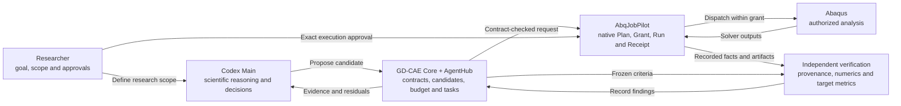
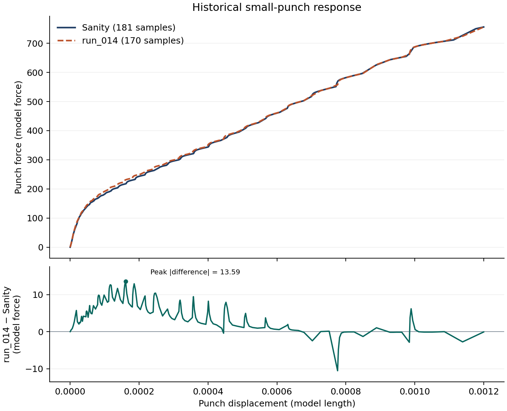

# Goal-Driven CAE Orchestrator

**From simulation automation to autonomous scientific investigation.**

GD-CAE is an autonomous, goal-driven and verifiable CAE research orchestration system. It connects a scientific question to a qualified model, controlled numerical experiments, independent verification, and a reasoned decision about the next experiment.

It is built for researchers and engineers in computational mechanics, materials science, manufacturing, finite element analysis, CAE automation, and scientific agents.

[Real Abaqus case](#real-abaqus-study) · [Quick start](#quick-start) · [Architecture](#architecture-and-workflow) · [Documentation](#documentation) · [Contributing](#contributing)

## What GD-CAE delivers

A conventional automation pipeline executes a prescribed sequence. GD-CAE organizes the **investigation** around a research goal. It records what may change, which observations count, how the evidence will be judged, and why the study should continue, pause, or stop.

| Capability | Role in a study |
| --- | --- |
| **Verified-model-first methodology** | Establish a baseline for a defined research purpose, with explicit invariants, validation evidence, and limits of use. |
| **Research contracts and controlled autonomy** | Persist objectives, candidate identities, allowed changes, evidence requirements, acceptance criteria, and budgets in a ResearchProject. |
| **Native execution and evidence** | Delegate authorized Abaqus work to AbqJobPilot and retain the Plan, Grant, Run, Receipt, and output provenance. |
| **Independent verification and feedback** | Evaluate outputs against frozen criteria and independent references, then use the measured residuals to justify the next candidate. |
| **Modular agent coordination** | Keep scientific reasoning in Codex Main and bind scoped specialist tasks and evidence handoffs through AgentHub when the host supports the required controls. |

## Real Abaqus study

**Abaqus Full Analysis → native execution evidence → independent ODB verification → scientific feedback → next parameter decision**

A controlled Abaqus/Standard 2024 study used a three-dimensional tensile bar with bilinear plastic hardening to test a two-parameter calibration workflow against a **synthetic** force–displacement target. Candidate A used a yield stress of **250 MPa** and a hardening modulus of **2,000 MPa**.

| Evidence layer | Observed result |
| --- | --- |
| **Real solver execution** | One authorized Full Analysis completed. |
| **Native execution evidence** | The original Plan, Grant, Run, and Receipt matched the recorded artifacts. The independent review rehashed the INP, ODB, STA, MSG, and DAT. |
| **Independent numerical verification** | A separate read-only extraction examined 101 ODB frames. All 11 predeclared numerical checks passed, including end-force balance, elastic and plastic stiffness, and plastic-strain checks against analytic references. |
| **Research target satisfaction** | **Target miss.** The endpoint was 267.453 N against 313.546 N. The full-curve NRMSE was 12.45%, above the frozen 1% limit. |

<details>
<summary>Frozen target criteria and Candidate A scores</summary>

| Metric | A error | Allowed maximum |
| --- | ---: | ---: |
| Full-curve NRMSE | 12.45% | 1% |
| Endpoint relative error | 14.70% | 1% |
| Yield relative error | 13.19% | 2% |
| Plastic slope relative error | 33.08% | 5% |

</details>

The validated response was too low at yield and too shallow after yield. Main used the measured A curve and the target residuals to propose **Candidate B**, with **288 MPa** yield stress and **3,003 MPa** hardening modulus. Raising yield stress addresses the force deficit near yield. Increasing the hardening modulus addresses the post-yield slope. The A feedback was committed and its attempt settled once after a controlled recovery of the terminal evidence record.

**Candidate B is the next research decision.** Its proposal and preparation passed the applicable scientific and offline checks. The latest live handoff stopped at the terminal focus check before readiness. B has no solver result or ODB, so the second experiment and the full A-to-B verification remain open. The tensile findings concern this synthetic target and benchmark model. The repository publishes this evidence summary. The raw tensile artifacts and independent review records are outside the source distribution.

## Architecture and workflow



- **Codex Main** interprets the scientific question, proposes experiments, and explains decisions. Specialist work can cover model inspection, results analysis, inverse methods, and independent review.
- **GD-CAE Core and AgentHub** own the research records and coordination. Core manages ResearchProject state, contracts, budgets, candidate checks, and verification records. AgentHub binds tasks to project, role, and evidence. The session adapter requires the host to enforce the configured role and tool scope.
- **[AbqJobPilot](https://github.com/BrunelXian/AbqJobPilot)** owns authorized Abaqus execution, including the native job lifecycle and its evidence. The researcher approves an exact execution scope separately from the scientific agreement.

### Start from a model qualified for the question

A **Sanity Model** is GD-CAE's term for an engineering baseline qualified for a particular research purpose. Its identity includes the model and dependencies, the physics and assumptions that matter to the comparison, and the evidence that justifies using it. A model may come from a researcher or be developed as a candidate for qualification. A calibration study can vary material parameters while holding the mesh, loading, boundary conditions, and measurement definitions fixed. A different question may require different invariants. [Sanity Model guide](docs/user/SANITY_MODEL_USER_GUIDE.md)

### Put the rules and evidence on record

A **ResearchProject** is the durable record of the investigation. Its frozen engineering bundle binds the goal, model, and verification contracts. In projects with versioned research agreements enabled, the researcher can review the scope, scientific claims, known unknowns, and revision history. An agreement sets the scientific rules. An exact native Grant governs a particular execution.

Verification distinguishes provenance, model integrity, numerical health, goal acceptance, and physical validation. An independent check needs the right input and output identities, region and step selectors, units, and acceptance rule. A converged analysis can miss the target, as A did. Physical claims require independent evidence appropriate to the intended use. [Verification architecture](docs/adr/ADR-004-execution-evidence-research-verification.md)

## Quick start

### Reproduce a published curve comparison

From the repository root, run the bundled small-punch case with Python 3. It uses only the standard library and the checked-in CSV files.

```sh
python product/research-preview/release/case/recompute.py
```

The endpoint changes by about **−0.0103%**, while the full-curve RMS difference is **6.1338** in model force units. This is why endpoint agreement alone cannot establish equivalence. The figure compares historical ODB-derived curves and their pointwise difference. [Case notes and data provenance](product/research-preview/release/case/CASE.md)

<p align="center">
  
</p>

### Build and install the Research Preview

The source tree builds local installation media for **`gdcae-research:research`**. Use Windows PowerShell and a verified Windows CPython **3.12.10**. Installation uses a Codex Desktop client and CLI with local Marketplace support. The build itself needs neither a solver nor an external model. [Build and verification commands](product/research-preview/README.md)

Extract the inner installation ZIP and follow its generated `INSTALL.md` to register the Marketplace, install the plugin, bind the interpreter, and run `doctor`. The installed `main` action analyzes an authorized external SMALL-PUNCH project with the required inputs and provenance files. The `agreement` action exposes versioned research agreements for explicitly enabled projects. The checked-in CSV example above runs independently of both. [Installation template](product/research-preview/INSTALL.template.md) · [Research agreement commands](plugins/gdcae-research/references/research-agreement.md)

## Current scope and roadmap

| Surface | Current scope |
| --- | --- |
| **Research Core** | Persistent ResearchProjects, frozen contract bundles, versioned agreements, candidate checks, budget records, and bounded evidence interfaces. |
| **Codex Research Preview** | The installed beta.1 Desktop preview passed historical small-punch analysis and malformed CSV rejection. The current source adds versioned Markdown agreement views. Desktop activation is version-specific. The AOO Desktop adapter blocks specialist chat creation where it cannot bind role and tool restrictions. |
| **Solver backend** | The demonstrated real path uses a separately qualified AbqJobPilot integration with Abaqus/Standard 2024 on Windows. The public Research Preview provides historical analysis and agreement tools. |

The next milestone is to execute and independently evaluate B under the same frozen criteria. Subsequent research priorities are to package reproducible evidence for external review, qualify specialist handoffs on supported hosts, and test the methodology on small-punch material inversion and laser deposition scan-order studies. Those studies will help establish where goal-driven orchestration improves on a fixed script, design of experiments, or optimizer.

## Documentation

| Read this | For |
| --- | --- |
| [Sanity Model guide](docs/user/SANITY_MODEL_USER_GUIDE.md) and [model-understanding protocol](docs/architecture/AGENT_MODEL_UNDERSTANDING_AND_SANITY_PROTOCOL.md) | Qualifying a baseline, defining allowed changes, and interpreting model evidence. |
| [ResearchProject and contract design](docs/architecture/M02_RESEARCH_PROJECT_AND_CONTRACTS.md) | Project identity, frozen engineering bundles, and persistence. |
| [Execution and verification ADRs](docs/adr/ADR-003-codex-native-delegated-execution.md) · [Verification layers](docs/adr/ADR-004-execution-evidence-research-verification.md) | Authority boundaries and the distinction between solver facts and research claims. |
| [Plugin skill](plugins/gdcae-research/skills/research/SKILL.md) · [Release maintenance](product/research-preview/README.md) | User-facing entry points, installation, and reproducibility. |

### Repository structure

| Directory | Contents |
| --- | --- |
| [`src/aegiscae/`](src/aegiscae/) | Research state, contracts, Main runtime, scoped session coordination, and Abaqus evidence adapters. The Python distribution retains the name `aegiscae`. |
| [`plugins/`](plugins/) | Codex skills, specialist role definitions, and bounded launchers. |
| [`product/research-preview/`](product/research-preview/) | Local installation media tooling, templates, and the reproducible historical case. |
| [`docs/`](docs/) · [`tests/`](tests/) | Architecture decisions, user guides, and unit, integration, and architecture checks. |

<!-- research-qa:start -->
## Researcher FAQ

1. **What does GD-CAE help me do?** It links a research question to a model, controlled variants, observations, and evidence for the decision to continue or stop.
2. **What is a Sanity Model?** A baseline qualified for a particular research purpose, with explicit assumptions, evidence, and limits of use.
3. **Who can create the baseline?** A researcher can bring a model, and an agent can propose a candidate model for qualification. Both need evidence appropriate to the intended use. The historical comparison uses existing project data.
4. **What is a Research Contract?** A versioned agreement within a ResearchProject that links the research question, model, permitted changes, observations, acceptance criteria, and scientific boundaries.
5. **What may an agent change?** Only variables within the confirmed scope. The research question determines whether material, geometry, analysis steps, loads, interactions, or scan order are variables or invariants.
6. **Does convergence establish validity?** Convergence answers a numerical question. Goal satisfaction and physical validity require their own checks and applicable reference evidence.
7. **How are research terms revised?** In an enabled project, review the proposed differences, reasons, and impact, then explicitly confirm the exact proposal digest. The prior version stays effective until confirmation.
8. **Does confirming a contract authorize a solve?** Execution requires a separate native Grant for the precise candidate and scope, with its own resources, limits, and expiry.
9. **How does this differ from fixed automation?** Fixed automation repeats a prescribed procedure. A research workflow uses verified outcomes to decide which experiment is informative and when the evidence supports a conclusion.
10. **What can I use today?** The Research Preview supports historical small-punch analysis and versioned research agreements. The controlled tensile study separately demonstrated a real A solve, independent ODB checks, and a B proposal driven by measured feedback.
<!-- research-qa:end -->

## Contributing

Peer review is welcome, especially on model qualification, verification criteria, solver evidence, and agent handoffs. Use a GitHub issue or pull request if you have repository access. For a reproducibility report, include the revision, environment, a minimal shareable input, the expected result, and the observed evidence. Share only artifacts you have permission to publish.

## License

Goal-Driven CAE Orchestrator is licensed under the [Apache License 2.0](LICENSE). AbqJobPilot and Abaqus are separate products with their own terms.
