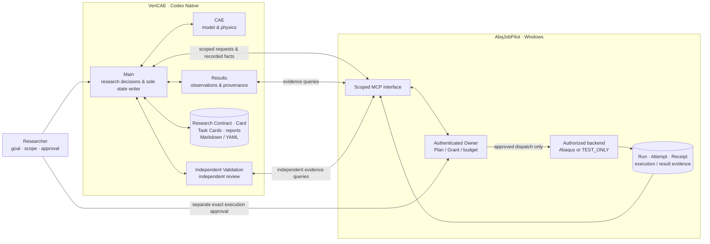

# VeriCAE

**Verifiable, goal-driven research agents for computational engineering.**

A simulation agent can give you a plausible result. **Can another engineer trace it to the right model, load, output selector and execution record—and independently check the conclusion?**

VeriCAE turns that question into a research workflow: define the claim, qualify a reference model, assign bounded tasks to native AI agents, and preserve the evidence behind each decision. **AbqJobPilot** is the companion Windows execution platform; it independently controls authorization, job lifecycle and provenance.

**v1.0.0 · First Open-Source Release · Research-oriented engineering software**

[**Download VeriCAE**](https://github.com/BrunelXian/Goal-Driven-CAE-Orchestrator/releases/tag/v1.0.0) · [**Try without Abaqus**](#try-it-without-abaqus) · [Architecture](ARCHITECTURE.md) · [Engineering case study](docs/vericae/ENGINEERING-CASE-STUDY.md) · [AbqJobPilot for Windows](https://github.com/BrunelXian/AbqJobPilot/releases/tag/v1.0.0)

> **Scope:** Research planning, persistent native-agent coordination, evidence review and independent validation are available. An unrestricted, newly initiated **REAL Abaqus** autonomous solve-and-extract loop has **not** passed end-to-end qualification. We distinguish software capability, tested integration and evidence qualification below.

## What Can You Investigate with VeriCAE?

<picture>
  <source media="(prefers-color-scheme: dark)" srcset="docs/vericae/images/research-applications-dark.svg">
  
</picture>

*Illustrative research directions supported by VeriCAE's planning, investigation and verification workflow. These examples are not claims of completed end-to-end real-solver validation.*

## Architecture: scientific decisions ≠ execution authority



**Two products, two responsibilities.** VeriCAE owns the scientific question, research state, task assignment and scientific conclusion. It does not introduce a second executor or task database. AbqJobPilot owns execution admission, the authenticated Owner/Supervisor, budgets, attempts, receipts and their evidence. A research agreement **does not** itself authorize a solve.

[Detailed architecture and trade-offs](ARCHITECTURE.md) · [Native role protocol](product/vericae/vericae-research/references/cross-thread-protocol.md) · [Pinned compatibility and limits](COMPATIBILITY.md)

## A real study: the right answer was not the whole verdict

In **INT-001**, four native roles reviewed a *historical real Abaqus* T3D2 axial-bar run. For a 10 mm bar with `E = 1000 N/mm²`, `A = 1 mm²` and an axial load of `−1 N`, CAE independently obtained the expected displacement `−0.010 mm`. Results compared it with the recorded DAT observation. Independent Validation recomputed the comparison and corrected a step-name attribution.

| Check | Observed result |
| --- | --- |
| Analytical tip displacement | **−0.010 mm** |
| Historical Abaqus DAT | **−0.010000000 mm** |
| Diagnostic JSON vs DAT, absolute difference | **2.235174179 × 10⁻¹⁰ mm** |
| Scientific/numerical comparison | **PASS for this load case** |
| Overall historical evidence qualification | **PARTIAL** |

**Why PARTIAL?** The historical extraction Receipt was `FAILED`; execution and extraction qualification remained `REVIEW_REQUIRED`; the diagnostic JSON lacked the Owner-bound output digest required for full integrity. A matching displacement did not erase those limitations.


*Actual published evidence workbench (VS Code): frozen model input, case notes and replay instructions. This is not a screenshot of a simulated autonomous execution.*

[Read the engineering case study](docs/vericae/ENGINEERING-CASE-STUDY.md) · [INT-001 findings](docs/vericae/INT-001.md) · [Published evidence files](docs/vericae/demo/README.md)

## Try it without Abaqus

**Option A — Replay an engineering check (PowerShell, no solver or license).**

Clone the public repository and recompute the comparison from the published frozen input and historical observations:

```powershell
git clone https://github.com/BrunelXian/Goal-Driven-CAE-Orchestrator.git
cd Goal-Driven-CAE-Orchestrator
./docs/vericae/demo/replay.ps1
```

Expected: `Analytical / DAT comparison PASS` and `Historical evidence verdict PARTIAL`. This reproduces the arithmetic and checks the published file digests; **it does not rerun Abaqus or retroactively qualify the historical extraction**. [Method and provenance](docs/vericae/demo/README.md).

**Option B — Plan a new study with native agents (no Abaqus required).**

[Download the VeriCAE 1.0.0 plugin ZIP](https://github.com/BrunelXian/Goal-Driven-CAE-Orchestrator/releases/download/v1.0.0/VeriCAE-1.0.0.zip), verify its [SHA-256](https://github.com/BrunelXian/Goal-Driven-CAE-Orchestrator/releases/download/v1.0.0/VeriCAE-1.0.0.zip.sha256) and follow the [Codex Desktop installation guide](INSTALL.md). In your research Main conversation, start with:

> Plan a cantilever tip-displacement study. Identify the observable, units, reference model and acceptance criteria. Show the six-part Research Card before creating files.

**Initiate** prepares the research definition; **Conduct** resumes from the recorded Handoff; **Setup** checks the active environment and MCP availability. Confirm the project name and scope before formalizing a Draft. No Abaqus installation is required for planning and offline model review.

**Advanced — Controlled execution.** [AbqJobPilot 1.0.0](https://github.com/BrunelXian/AbqJobPilot/releases/tag/v1.0.0) installs separately on Windows. Live execution needs a configured environment, a healthy authenticated Owner, and a separate scoped Grant. **TEST_ONLY** is not a one-click substitute for Abaqus and its result must not be reported as a solver result.

## What's verified in v1.0.0?

| Study / surface | Evidence-backed status | What it **does not** prove |
| --- | --- | --- |
| Plugin distribution | **PASS:** isolated installation of v1.0.0; 34/34 packaged plugin files matched | New real-solver autonomy |
| **UAT-100** · development baselines 0.5.6 / 0.5.3 DEV | **PASS:** Codex Desktop made two actual read-only MCP calls to AbqJobPilot | Separate v1.0.0-to-v1.0.0 Desktop E2E qualification |
| **INT-001** · historical real Abaqus case | **PASS** for four-role coordination and the specified displacement check; **PARTIAL overall** | A fully qualified extraction, or a newly initiated solve |
| **INT-002A.1** · independent Fake bridge | **TEST_ONLY PASS:** Owner dispatch, same-Run readback, output hash, idempotency, restart evidence | Abaqus execution: `solver_conclusion=NOT_RUN` |
| **INT-002B** · new research task | **Planning PASS; execution BLOCKED / STOPPED** after the original Owner became unavailable | Successful new-task end-to-end execution |

The public 1.0.0 distributions are pinned in [COMPATIBILITY.md](COMPATIBILITY.md). The general new-Plan REAL execution-environment binding and an evidence-qualified, newly initiated real Abaqus closed loop remain future engineering milestones.

## Engineering design decisions

- **Claims are not receipts.** Numerical agreement, solver completion, process containment, artifact provenance and scientific validity are independent questions.
- **Agent intent is not permission.** An execution Grant is separate from a Research Contract and binds an exact scope and budget.
- **Uncertainty is preserved.** An interrupted Owner, missing output binding or `FAILED` extraction is recorded—not rewritten into success because downstream arithmetic matches.
- **Review is a first-class role.** Independent Validation checks the evidence and model instead of echoing another agent's answer.

[Architecture & responsibility boundaries](ARCHITECTURE.md) · [Full engineering narrative](docs/vericae/ENGINEERING-CASE-STUDY.md) · [Research agenda](docs/vericae/RESEARCH-AGENDA.md) · [MCP runtime recovery protocol](product/vericae/vericae-research/references/mcp-runtime-verification.md)

## Releases, licensing and contribution

**VeriCAE:** [v1.0.0 release](https://github.com/BrunelXian/Goal-Driven-CAE-Orchestrator/releases/tag/v1.0.0) · [Install](INSTALL.md) · [Apache-2.0](LICENSE).

**AbqJobPilot:** [v1.0.0 Windows release](https://github.com/BrunelXian/AbqJobPilot/releases/tag/v1.0.0) · [source repository](https://github.com/BrunelXian/AbqJobPilot) · MIT licensed. Abaqus is a separate commercial product and is not included.

Research feedback, reproductions and technical reviews are welcome through GitHub Issues or pull requests. Please share only models, outputs and evidence you have permission to publish.
