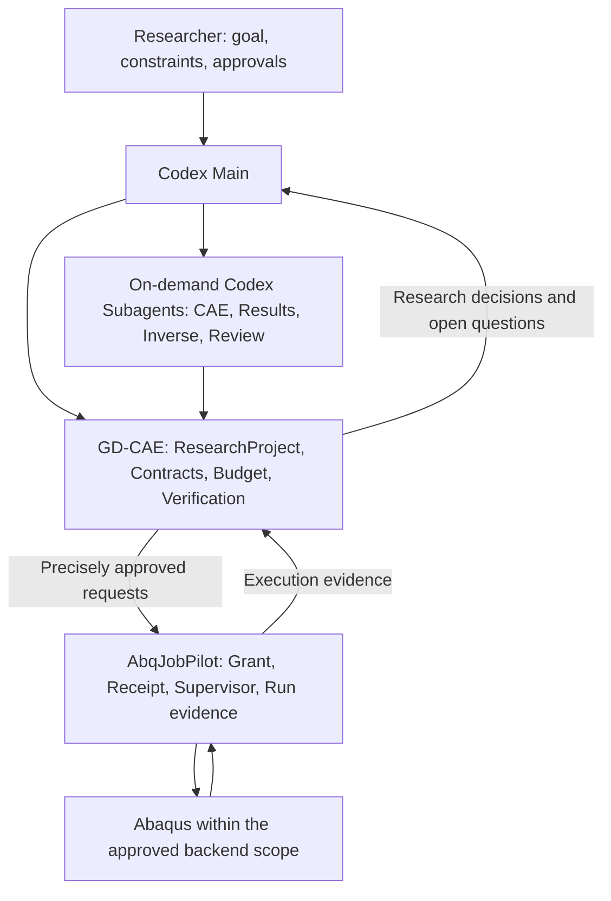

# Goal-Driven CAE Orchestrator

<!-- research-qa:start -->
## 研究者常问的 10 个问题

1. **GD-CAE 帮我做什么？** 从研究问题出发，把模型、候选变化、观测和接受依据联系起来，使研究者能追查每个结论的来源。
2. **什么是 Sanity Model？** 对指定研究用途已有验证依据的工程基准。应能指出用的是哪个模型、在哪些条件下可信、还有哪些未知。
3. **一定要我先做好模型吗？** 可以提供已有模型，也可以约定由 Agent 建立候选。两种来源都要通过适用性验证，当前只读预览接收已有历史项目。
4. **Research Contract 是什么？** 它是 ResearchProject 内带版本的科研约定，关联研究目标、基准、变量范围、比较条件、观测、误差限、证据和预算约束。Main 用它说明当前结论能支持什么主张。
5. **Agent 能自主改变什么？** 在确认的范围内可以改变材料、几何、分析步（Step）、载荷（Load）、相互作用（Interaction）或扫描顺序。不变量由比较问题决定，例如反演材料时可固定夹持条件，观测冲头力–位移曲线。
6. **求解收敛就算科研验真吗？** 收敛只说明这次数值计算完成。还需检验网格与步长敏感性，并用解析解、实验或独立参考检验所关心的观测。
7. **如何确认或修订科研约定？** 在启用科研约定的新项目中，向 Main 查看当前卡片或修订差异。核对新旧值、理由和影响后，明确确认具体提案摘要。旧版可按摘要重读，待确认提案保留原有效版本。
8. **确认合同就可以启动求解吗？** 真实求解另需对具体候选、资源、次数和有效期的执行授权。安装插件、阅读模型或同意研究方向均不授予此权限。
9. **与普通 Automation 有何区别？** 普通自动化可重复运行既定步骤。科研循环还要判断证据是否充分、候选是否可比、目标是否达到，并记录继续或停止的理由。
10. **现在可用哪些能力？** 安装态 Main 支持小冲杆历史比较，以及新项目科研约定的概览、详情、修订差异与版本提示。通用自建基准、原生富组件与真实求解闭环仍待开发或验收。
<!-- research-qa:end -->

详见[用户指南](docs/user/SANITY_MODEL_USER_GUIDE.md)、[Agent 模型理解协议](docs/architecture/AGENT_MODEL_UNDERSTANDING_AND_SANITY_PROTOCOL.md)和[发行构建说明](product/research-preview/README.md)。

## From verified models to verifiable discoveries

**An Agentic CAE Research Environment built around Codex as its sole Agent Harness.**

One researcher. One main conversation. Specialized engineering agents, called on
when the research needs them.

Goal-Driven CAE Orchestrator aims to help researchers carry a scientific question
from a trusted Abaqus model through controlled experiments to independently
checked conclusions. Its foundation is bounded autonomy: preserve the physical
problem, record each experiment, and make conclusions traceable to evidence.

**中文简介：** Goal-Driven CAE Orchestrator 面向拥有可信 Abaqus 模型的科研人员，以 Codex 为唯一 Agent Harness。研究者通过一个 Main 主对话提出科研目标、确认模型基线和授权边界；Codex 按需协调专业子 Agent，GD-CAE 管理持久科研状态、模型契约、预算和独立验真，AbqJobPilot 负责获批的 Abaqus 执行与作业证据。这是正在设计的产品方向，尚非已交付的自主科研工作流。

> **Current status: 7D-E2E-G3 execution-readiness work; real full-chain release is
> NO-GO.** The Python distribution remains `aegiscae`, version `0.0.0`.
> Earlier milestones provide persisted contracts, synthetic workflows and bounded
> evidence interfaces. G1 adds offline real-preview prerequisites and a source-only
> Plugin package. G2 adds reviewed local snapshot packaging and installed-Core
> initialization; it does not establish GitHub publication. Real dynamic dispatch,
> independent Operator isolation, installed
> `@GDCAE` activation and live A/B acceptance are not qualified. The broader
> researcher experience below remains a product target, not a demonstrated result.

See [the internal snapshot procedure](docs/architecture/7D_G2_PRODUCT_SNAPSHOT.md)
for exact-file export, local wheel installation, doctor and new research-project
initialization. The source distribution remains `0.0.0`; internal snapshot wheels
are marked `0.0.0+g2long` and `INTERNAL_CANDIDATE_NOT_FOR_RELEASE`.
The [G1 installation record](docs/architecture/7D_G1_PLUGIN_INSTALLATION.md) remains
historical context. These helpers neither install globally nor authorize Abaqus.
See [G3 product activation boundaries](docs/architecture/7D_G3_PRODUCT_ACTIVATION.md)
for installed distribution checks, initialization source receipts and the separate
local Plugin installation, native role-loading and Desktop activation gates.

## A persistent environment for computational research

Simulation supports hypothesis testing, parameter identification, model comparison,
diagnosis, and design-space exploration. Those activities often span model files,
solver logs, scripts, notebooks, experimental data, and many conversations.

GD-CAE is intended to connect them through a durable **ResearchProject** record:
the approved goal and model baseline, permissible changes, candidate identities,
execution references, budgets, verification results, and decisions. That record
must survive the end of an agent turn or the closure of a client.

The conversation is the primary interface. The persistent research record holds
research decisions; AbqJobPilot remains the authority for its execution facts.

### The intended researcher experience

1. **Bring a verified model.** Register an approved Abaqus baseline, its input
   dependencies, provenance, validation evidence, and known limitations.
2. **Define a research goal.** Specify observables, experimental data, constraints,
   units, tolerances, allowed changes, and a bounded execution budget.
3. **Work with Project Main.** Codex plans the investigation and delegates narrow
   tasks to specialized subagents when useful.
4. **Review controlled candidates.** Model changes receive explicit identities
   and pass contract checks before execution authorization is considered.
5. **Run approved experiments.** AbqJobPilot executes within its supported,
   precisely authorized scope and records job-level evidence.
6. **Examine the evidence.** Check provenance, numerical results, frozen goal
   criteria, and applicable independent references before accepting a conclusion.
7. **Continue, pause, or stop.** A supported but unmet goal may justify a new
   candidate. Unknown execution, missing evidence, changed physics, or exhausted
   authority must block further automatic action.
8. **Keep a reproducible record.** Preserve candidate inputs, execution bindings,
   result provenance, verification records, decisions, and scientific caveats.

Automatic continuation after an external job completes is a separate feasibility
milestone. Starting a programmatic Codex turn must not be assumed to resume the
researcher's original visible Main conversation.

## Verified-Model-First

The initial scope starts with trusted engineering assets and constrained changes.
Generating arbitrary complex CAE models from natural language (Text-to-CAE) is
outside the first implementation scope.

A valid input file alone does not establish a valid physical model. Contact,
material laws, sets and surfaces, boundary conditions, load histories, and thermal
interfaces carry engineering meaning that must be preserved or revalidated.

The planned **Model Contract** makes those assumptions and allowed mutations
explicit. Broader geometry, mesh, or physics changes would require new contract
versions and appropriate review. Baselines remain immutable; candidates are
derived in controlled workspaces.

## One Main, specialized expertise

Codex provides the agent harness and native subagent coordination. GD-CAE will
define domain roles and handoff contracts without implementing another multi-agent
framework. Specialists are used on demand rather than kept permanently active.

| Role | Intended responsibility | Structured handoff |
| --- | --- | --- |
| **Project Main** | Clarify the research question, coordinate work, and explain decisions and approval requests. | Research plan and agent tasks |
| **CAE Model** | Inspect baseline semantics and propose scoped model variants. | Candidate proposal and mutation manifest |
| **Results / ODB** | Specify admissible extraction and interpret traceable numerical data. | Extraction request and evidence references |
| **Inverse / Optimization** | Propose experiments and parameter candidates using appropriate numerical methods. | Parameter proposal, method, and uncertainty |
| **Independent Reviewer** | Challenge assumptions and identify missing evidence or validation. | Findings and unresolved concerns |

Reviewer opinions are distinct from machine verification records. Frozen,
deterministic checks should decide whether machine-checkable criteria are met;
an agent's self-report cannot substitute for those checks. Role instructions alone
also do not provide operating-system permission isolation.

## Proposed architecture

- **Codex proposes and reasons.** Main and subagents cannot issue their own real
  solver grants, change frozen acceptance criteria, or create authoritative
  verification records.
- **GD-CAE governs research state and acceptance.** It will manage contracts,
  candidates, budgets, evidence bindings, and research-level decisions. It must
  not become a second Abaqus process supervisor or write the execution backend's
  private database.
- **AbqJobPilot owns controlled Abaqus execution.** Its Agent-first service manages
  job-level authorization, receipts, process lifecycle, and observed execution
  evidence. A completed job does not establish a research conclusion.
- **The researcher approves the scientific scope.** Baselines, assumptions,
  consequential changes, and execution authority remain subject to explicit review.

These are logical responsibility domains. They do not require three distributed
microservices.

## Evidence and verification

The proposed verification model keeps distinct questions separate:

| Layer | Question |
| --- | --- |
| **V0 — Provenance** | Do the inputs, Run, attempt, outputs, versions, and hashes belong together? |
| **V1 — Model integrity** | Were mutations permitted and declared physical invariants preserved? |
| **V2 — Solver and numerical health** | Is there sufficient evidence of execution, convergence, and numerical reliability? |
| **V3 — Goal acceptance** | Do the metric, entity, step, units, and tolerance satisfy the frozen goal? |
| **V4 — Physical validation** | Is the model supported by applicable benchmarks, independent analysis, or experimental data? |

`UNKNOWN`, `INCONCLUSIVE`, and `NOT_ASSESSED` are meaningful outcomes. Solver
completion, artifact existence, and curve-fit quality must not silently become
claims of physical validity. Each goal must declare which checks are required.

## Research applications we are building toward

- **Small Punch material inversion.** Infer Hollomon parameters from measured
  force-displacement data and an approved model, examining fit quality,
  non-uniqueness, and contact and mesh assumptions.
- **LDED scan-order optimization.** Explore admissible scan sequences in trusted
  thermo-mechanical models while preserving element activation, evolving thermal
  boundaries, and the interpretation of deformation and stress metrics.
- **AFI-guided diagnostics.** Use Abaqus Failure Intelligence cases as sourced
  hypotheses, propose bounded diagnostic actions, and check whether a suggested
  numerical fix changes the physical problem.
- **Reproducible simulation studies.** Support controlled parameter sweeps,
  calibration, model comparison, and sensitivity analysis.

These are target use cases, not implemented workflows. Where a fixed script, DOE,
or numerical optimizer is sufficient, it should remain the baseline against which
agent assistance is evaluated.

## Engineering principles

- **Verified-Model-First:** preserve approved baselines and their scope of validity.
- **Persistent goals:** keep contracts, budgets, evidence, and decisions beyond a turn.
- **Evidence-governed autonomy:** separate proposals, authorization, and verification.
- **Single execution authority:** use the approved AbqJobPilot path for Abaqus work.
- **Conservative recovery:** query the original execution identity after an uncertain
  response; do not silently retry with a new request identity.
- **Fail closed:** stop advancement when identity, evidence, or authorization is unclear.
- **Reproducibility:** record rejected candidates and inconclusive results as well as
  successful experiments.

## Roadmap

Milestones describe planned work, not shipped functionality or execution permission.

| Milestone | Intended outcome |
| --- | --- |
| **M00-P — Architecture and product reconciliation** | Review Codex-native UX, authority boundaries, legacy ADR conflicts, and research-state contracts. Audit completed; decisions await review. |
| **M01 — Read-only evidence bridge** | Inspect bounded AF evidence through explicit Project bindings; verify synthetic contracts and isolated AF compatibility separately. |
| **M02 — Research and model contracts** | Implement frozen goals, model constraints, candidate checks, budgets, and deterministic verification records. |
| **M03 — Offline research loop** | Prove persistent, recoverable two-step workflows with Fake/Python fixtures and no Abaqus calls. |
| **M03-E — Codex continuation** | Test event-driven continuation, duplicate-event handling, and original visible Main-thread recovery separately. |
| **M04 — Real bounded Abaqus loop** | Following separate backend-extension and execution approvals, demonstrate legal parameter variants and independently checked outcomes. |
| **M05 — Reliability benchmark** | Measure unsafe acceptance, recovery behavior, diagnostic quality, and cost against simpler baselines. |
| **M06 — Domain research trial** | Conduct a nontrivial Small Punch inversion study with model, data, and uncertainty checks. |
| **M07 — Researcher experience** | Package installation, diagnostics, project initialization, documentation, and reproducible use. |

## Current implementation and historical records

The repository was renamed from **AegisCAE Runtime**. It contains ResearchProject
persistence, frozen contracts, budgets, candidate guards, evidence bridges and
offline workflow/verification implementations alongside historical architecture
records. These local capabilities do not establish qualified real A/B execution
or a released end-user installation workflow.

The separate [AbqJobPilot](https://github.com/BrunelXian/AbqJobPilot) project has a
limited, historically tested Agent-first execution MVP on its Develop line. At the
M00-P reviewed baseline, its normal product path is restricted to a fixed Standard
input and a single provisioned Plan/Run. Historical fixed DAT checks do not prove
arbitrary model support or ODB content verification. Parameterized multi-candidate
execution and controlled ODB extraction require separately reviewed extensions.

The documents below preserve the earlier architecture and its rationale. Existing
ADR-001/002 retain earlier decisions; current governance documents distinguish
those historical records from the Codex-native and AF authority boundaries.
This README does not rewrite or supersede any ADR.

- [Historical architecture](ARCHITECTURE.md)
- [Existing runtime invariants](RUNTIME_INVARIANTS.md)
- [Historical threat model](THREAT_MODEL.md)
- [Legacy migration decisions](MIGRATION_FROM_LEGACY.md)
- [Frozen baseline register](docs/baseline/BASELINE_REGISTER.md)
- [Milestone 0 implementation plan](docs/milestones/MILESTONE_00_IMPLEMENTATION_PLAN.md)
- [ADR-001: Runtime-first](docs/adr/ADR-001-runtime-first.md)
- [ADR-002: Selective legacy migration](docs/adr/ADR-002-legacy-selective-migration.md)

**The ambition:** a research environment in which every experiment has an identity,
every conclusion has evidence, and every autonomous action has a defined boundary.
