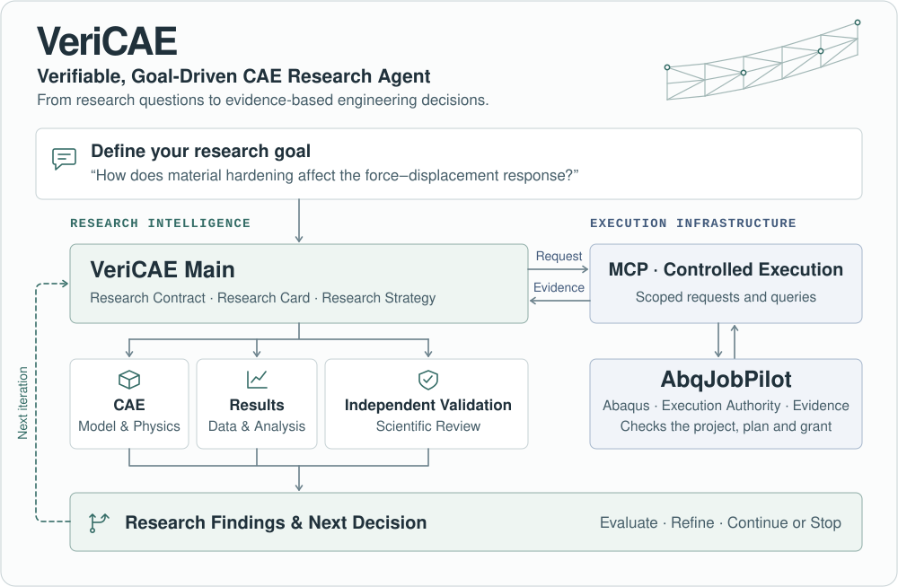
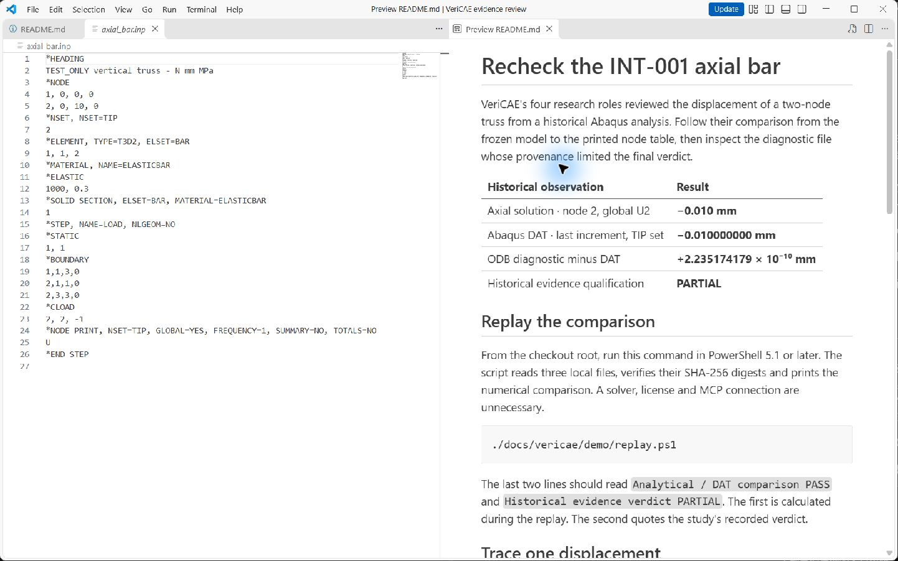

# VeriCAE

**可验证、目标驱动的 CAE 科研智能体**

[English](README.md) ·  · [公开源码](product/vericae/) · [Apache-2.0 许可证](LICENSE)

## VeriCAE 是什么，可以做什么？

VeriCAE 帮助工程师在 Codex 中规划和审查计算研究。**目标驱动的研究（Goal-Driven Research）** 从三个问题开始。要研究什么、观测哪个量、满足什么条件就可以停止。Initiate 将研究范围与验收准则写入 Research Contract 和 Research Card。团队从可核验的参考模型起步，设计数值实验，再将证据交由独立角色复核。研究者可以据此决定下一步该改变哪个条件，或结束研究。

<picture>
  <source media="(prefers-color-scheme: dark)" srcset="docs/assets/research-workflow-dark.svg">
  
</picture>

Conceptual research workflow illustration, not a screenshot of a completed end-to-end live solver run. 此图为科研工作流概念示意。

<table>
<tr>
<td width="50%" valign="top"><strong>01 · 材料参数与样件反演</strong> 将小冲杆试验的实测响应与仿真预测对照，反推样件的材料参数。</td>
<td width="50%" valign="top"><strong>02 · 基于仿真的科学探索</strong> 设计一组力学数值实验，检验候选尺度律与无量纲关系。</td>
</tr>
<tr>
<td valign="top"><strong>03 · 工程设计与制造工艺优化</strong> 在工程约束下比较工艺参数或扫描策略，选择值得进一步验证的方案。</td>
<td valign="top"><strong>04 · 机理分析与参数敏感性研究</strong> 改变载荷、材料或几何条件，辨别影响失效、变形或非线性响应的主导因素。</td>
</tr>
</table>

以上示例说明 VeriCAE 面向哪些研究提供规划、组织和验证支持。v1.0.0 尚未对全部场景完成真实求解器的端到端验证。

## VeriCAE 如何组织研究与执行？

展开科研与执行工作流图

<picture>
  <source media="(prefers-color-scheme: dark)" srcset="docs/assets/research-workflow-dark.svg">
  
</picture>

**VeriCAE 负责科研判断。** Main 是主要科研状态的唯一写入者。它通过 Task Card 向 CAE、Results 和 Independent Validation 分派任务，读取各角色的原始回复，再记录下一步判断。Research Card、交接记录和报告保存在项目文件中。角色对话由 Codex 提供，无需单独部署 VeriCAE 运行时或数据库。[技术架构](ARCHITECTURE.md)

**AbqJobPilot 负责受控执行。** 它核对执行计划（Plan）及其授权（Grant），在 Windows 上监督获准的作业，并通过 MCP 返回执行记录。科研协议本身不授予求解权限。[执行平台](https://github.com/BrunelXian/AbqJobPilot) · [兼容性与验证范围](COMPATIBILITY.md)

### 真实研究证据

*INT-001 的公开回放工作台。VS Code 左侧为冻结的输入文件，右侧为历史案例数据。*

**数值核验通过（PASS）。** 节点 2 的轴向位移解析值与历史 Abaqus DAT 表均为 **−0.010 mm**。**整体证据结论为 PARTIAL。** 原始提取回执记录了失败，历史记录也不足以确认诊断输出文件的产生方。公开回放可以离线复算数值。新求解任务的完整执行与输出仍需单独验证。[离线复算步骤](docs/vericae/demo/README.md) · [案例记录](docs/vericae/INT-001.md)

## 如何安装和开始使用？

1. 从 [VeriCAE 1.0.0 正式发布页](https://github.com/BrunelXian/Goal-Driven-CAE-Orchestrator/releases/tag/v1.0.0)下载[插件 ZIP](https://github.com/BrunelXian/Goal-Driven-CAE-Orchestrator/releases/download/v1.0.0/VeriCAE-1.0.0.zip) 和 [SHA-256 校验文件](https://github.com/BrunelXian/Goal-Driven-CAE-Orchestrator/releases/download/v1.0.0/VeriCAE-1.0.0.zip.sha256)。按[安装指南](INSTALL.md)校验、解压，并将目录注册为 Codex 本地插件市场。
2. 在 Codex Desktop 打开研究工作区，选择 **Initiate CAE Research**。可以先问“请规划一个悬臂梁端部位移研究，在创建文件前列出观测量、参考模型和验收准则。”

用 **Conduct** 恢复研究，用 **Setup** 检查当前会话中可用的工具。科研规划和离线审查只需 VeriCAE。需要接入受控执行时，请参阅 [AbqJobPilot 1.0.0 Windows 正式发布页](https://github.com/BrunelXian/AbqJobPilot/releases/tag/v1.0.0)。

## 谁在开发和维护？

Xian（BrunelXian）维护 VeriCAE 和 AbqJobPilot。VeriCAE 的 Codex Native 技能、角色定义和科研模板在本仓库公开。AbqJobPilot 作为独立 Windows 执行平台单独发布。[VeriCAE 源码](product/vericae/) · [AbqJobPilot 源码](https://github.com/BrunelXian/AbqJobPilot) · [维护者](https://github.com/BrunelXian)

## 未来的研究计划是什么？

长期研究的问题是，什么证据足以支持智能体选择下一次数值实验？v1.0.0 之后的研究议程包括验证从授权到输出复核的全新求解任务，在固定预算下比较实验选择策略，以及检验哪些核验方法可迁移到其他求解器和耦合物理场。[科研议程与实验设计](docs/vericae/RESEARCH-AGENDA.md) · [开发历史归档](docs/archive/README.md)
