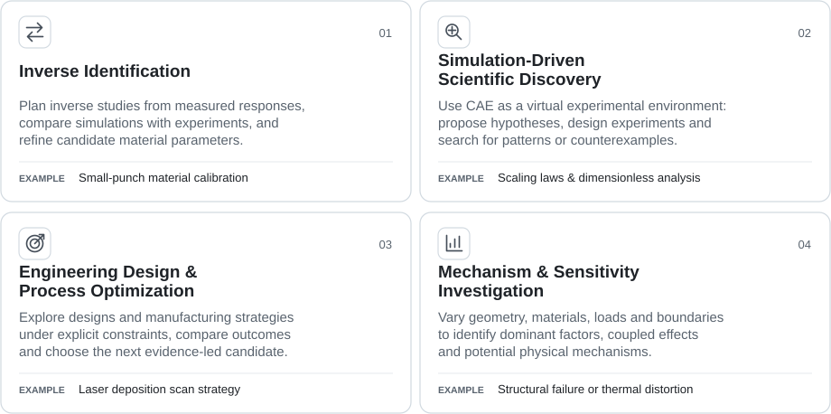

<div align="center">


# VeriCAE

**可验证、目标驱动的 CAE 科研智能体**

*从科研问题出发，形成有证据支撑的工程判断。*

[English](README.md) · **简体中文**

[](https://github.com/BrunelXian/Goal-Driven-CAE-Orchestrator/releases/tag/v1.0.0)
[](LICENSE)
[](ENGINE.md)
[](ENGINE.md)
[](https://github.com/BrunelXian/AbqJobPilot/releases/tag/v1.0.0)

</div>

## 1. VeriCAE 是什么？

VeriCAE 是面向计算工程的开源 AI 科研框架。研究者不必预先规定每一个仿真步骤，而是从科研目标出发，由 VeriCAE 协助组织科研团队、提出科学假设、规划数值实验、审查模型、分析证据，并决定下一步研究方向。

三个核心原则：**Verified-Model-First**（从针对研究问题完成资格评估的模型出发）、**Goal-Driven**（目标与约束驱动）、**Verifiable**（以证据与独立审查支撑科学结论）。

### 可以开展哪些研究？

<picture>
  <source media="(prefers-color-scheme: dark)" srcset="docs/vericae/images/research-applications-dark.svg">
  
</picture>

上述场景展示框架可以用于规划、组织和验证的研究方向，不代表每个场景均已完成真实求解器的端到端验收。

## 2. VeriCAE 如何工作？

<picture>
  <source media="(prefers-color-scheme: dark)" srcset="docs/vericae/images/research-workflow-dark.svg">
  
</picture>

### 科研工作流程

1. **Initiate CAE Research**：明确研究问题、范围、验收准则，建立 Research Contract 与 Research Card。
2. **Conduct CAE Research**：Main 管理科研状态，通过 Task Card 协调 CAE（模型与物理）、Results（结果与证据）和 Independent Validation（独立验证），汇总发现并提出下一步科研判断。
3. **Set Up Research Environment**：需要计算工具时，检查实际运行环境、MCP 可用性及服务身份。

### 双层架构

VeriCAE 使用 Codex Native 持久化角色会话，科研状态保存为 Markdown/YAML 文件，不需要独立的 VeriCAE Runtime 或数据库。Main 是主要科研状态的唯一写入者，角色分工和任务范围属于工作流约束，而不是宿主强制安全沙箱。

[**AbqJobPilot**](https://github.com/BrunelXian/AbqJobPilot) 是独立的 Windows 执行平台，通过 MCP 管理执行授权、作业生命周期和执行证据。Research Contract 不等于执行 Grant。上图展示目标工作流程，通用全新真实 Abaqus 任务的端到端执行仍未完成资格验证。历史轴向杆案例的数值核验通过，整体证据裁定为 PARTIAL。

[技术内核](ENGINE.md) · [工程案例](docs/vericae/ENGINEERING-CASE-STUDY.md) · [兼容性与验证范围](docs/COMPATIBILITY.md)

## 3. 安装

VeriCAE 1.0.0 需要支持本地插件 Marketplace 的 Codex。科研规划和离线模型审查不要求安装 Abaqus。

1. 下载 [VeriCAE-1.0.0.zip](https://github.com/BrunelXian/Goal-Driven-CAE-Orchestrator/releases/download/v1.0.0/VeriCAE-1.0.0.zip)，核对 [SHA-256](https://github.com/BrunelXian/Goal-Driven-CAE-Orchestrator/releases/download/v1.0.0/VeriCAE-1.0.0.zip.sha256)，解压至长期保留的目录。
2. 在包含解压后的 `VeriCAE-1.0.0` 文件夹的目录打开 PowerShell，执行：

```powershell
codex plugin marketplace add ./VeriCAE-1.0.0
codex plugin add vericae-research --marketplace vericae-public --json
codex plugin list --marketplace vericae-public --json
```

3. 在 Codex Desktop 打开研究工作区，确认三个 Skill 均为 1.0.0，使用 **Initiate CAE Research** 开始科研规划。

例如：*规划一个悬臂梁端部位移研究，明确参考模型与验收标准，在创建文件前向我展示 Research Card。*

**可选执行平台：** [下载 AbqJobPilot 1.0.0 Windows x64 安装包](https://github.com/BrunelXian/AbqJobPilot/releases/download/v1.0.0/AbqJobPilot-1.0.0-Windows-x64-Setup.exe)。安装包尚未签名。真实计算需要自行提供合法 Abaqus 安装、配置并使用经授权且受支持的执行环境。

[完整安装说明](docs/INSTALL.md) · [兼容性与要求](docs/COMPATIBILITY.md) · [无需 Abaqus 的离线数值复算](docs/vericae/demo/README.md)

## 4. 开发者与贡献

**项目维护者：** [BrunelXian](https://github.com/BrunelXian)。

项目采用人类主导科研方向、架构决策与验收审查的 AI 辅助工程开发方式，使用 ChatGPT 与 Codex 协作。欢迎贡献、复现验证及科研合作。VeriCAE 使用 [Apache-2.0](LICENSE) 许可证，AbqJobPilot 使用 MIT 许可证。

## 5. 未来计划

以下为后续工程与科研方向，并非 1.0.0 已完成的功能：

- **自主数值实验：** 完善通用执行环境绑定、全新真实求解任务及独立结果验证。
- **仿真驱动的科学发现：** 探索科学假设、尺度律、无量纲关系、反例搜索及有预算约束的实验选择。
- **材料与制造科研：** 小冲杆和拉伸实验反演、工程优化与增材制造工艺研究。
- **多求解器与多物理场：** 探索更多 CAE 后端，以及可验证的热力耦合与流固耦合工作流。

[科研议程](docs/vericae/RESEARCH-AGENDA.md) · [当前验证范围](docs/COMPATIBILITY.md)
