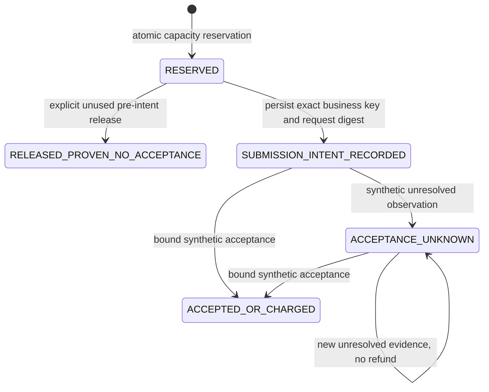

# M02-B2 — Transactional BudgetLedger

G1 design recorded before implementation; implemented and exercised in G2/G3. Qualification:
**BUDGET_LEDGER_SYNTHETIC_PASS only**. Actual results are in the delivery report.

## Identity, unit and authority

One slot is one conservative execution-attempt allocation, not an observed process start.
Each reservation costs exactly one slot from frozen Goal.budget.max_solver_calls. Zero means
no reservation. Proposal/Turn/wall-time budgets are not implemented. A reservation binds Project,
exact Bundle/Goal IDs and versions, all four frozen digests, Candidate ID/output digest, independent
operation key, immutable intended synthetic downstream business key and optional Plan digest.
A Plan digest is a proposal label, not an approved Abaqus Plan.

The first reservation pins one Project-wide budget account to exact frozen refs. A later freeze
cannot create a new quota pool or drop old held/charged exposure. New allocations under other
refs are rejected; existing reservations can still be settled using their original refs.
Policy replacement/reset requires a separately reviewed design. Downstream keys are unique for
the lifetime of this account, even across released reservations; changing operation keys cannot
reuse an intent or evade UNKNOWN accounting.

Only synthetic Candidate publication membership is required for accounting; this does not
certify current staged-file availability or make NOT_ABAQUS_QUALIFIED runnable. No Submit,
Grant, Solver/ODB start, network, AF discovery or workflow capability is introduced.

## Accounting and transition model

`available = limit - charged - held >= 0`. RESERVED, SUBMISSION_INTENT_RECORDED and
ACCEPTANCE_UNKNOWN all hold one slot. ACCEPTED_OR_CHARGED consumes one slot permanently under
this policy; converting held to charged is not a second debit. RELEASED_PROVEN_NO_ACCEPTANCE
occupies neither, and is reachable only by explicit checked release before any recorded intent.

Post-intent release is deliberately unsupported in B2. Timeout, lost response, missing Receipt,
expired time, process death or a new Turn never refund capacity. Accepted/charged is terminal;
unknown or contradictory observations cannot undo it. Duplicate requests/observations replay
the original result without another revision or charge. An ambiguous journal blocks operations.

Budget accounting, downstream acceptance/Grant consumption and actual Solver start are distinct.
All persisted acceptance observations are labelled synthetic; real acceptance/Grant consumption
and Solver start remain unestablished. An explicit in-memory synthetic oracle issues bound typed
observations; dictionaries/agent prose cannot be submitted as evidence. Its local capability is
not an authentication system or defence against arbitrary same-user Python code. No oracle secret
is persisted. Even a valid synthetic observation never becomes a real Receipt or VerificationRecord.

## Persistence and compatibility

Use the existing Project SQLite transaction authority and audit table. Append `budget-event-v1`
payloads; replay them deterministically to reconstruct reservations/counters, checking each stored
sum against the derived invariant. No second database/counter or immutable-contract migration.
All budget mutations atomically append an audit event and update Project revision/time/transaction.
Ledger revision advances once per budget event. Reads never initialize, upgrade or repair.

Explicit semantic extension: Project revision now orders **contract and budget mutations**;
older B1 documents describe the earlier contract-only stage. Historical values/bytes do not change.
Candidate events continue to be audit observations without revision increments. Their current
parent means the latest frozen Bundle at that event position, not the latest budget revision.
Freeze rows can consequently have revision gaps accounted for by budget events. Re-reading walks
the complete audit sequence and verifies every increment and the final Project stamp. Old binaries
reject the new event kind; do not use old writers after budget events. No SQL table migration is needed.

Each write uses BEGIN IMMEDIATE, verifies exact scope and current revision, checks idempotency
before allocating, then commits record/revision together. Independently running clients cannot
allocate beyond the frozen limit. Same operation key/different semantic content conflicts.
Replay excludes the caller's retry revision from the semantic request; original results remain
available after a response is lost, with explicit original/current revision reporting.

## Failure boundaries

Retain existing STORE_BUSY policy for any journal/WAL/SHM. No removal, repair, force unlocking,
auto retry, time refund or external reconciliation. A crash leaves old or once-committed state,
or a blocked/quarantined store requiring future administrative review. SQLite cannot be atomic
with a future AF side effect: recording intent first is essential, but this milestone never makes
that external call. Hashes/event links detect inconsistencies, not coordinated rewriting by a host
administrator. Bounded audit capacity and same-user filesystem races remain limitations.

M03-A is a separate Fake two-step workflow proposal only; no runner or continuation is implemented.

## Implemented API and event contract

`research.budget_rules.BudgetScope.from_bundle(bundle)` captures Project ID, Bundle/Goal IDs
and versions and all four frozen digests. `research.budget.BudgetLedger(project, scope, oracle=None)`
uses an explicitly opened Project handle; reads accept readonly handles, writes require explicit
write handles. Methods are:

- `inspect_budget()` — current consistent snapshot: scope, limit/held/charged/available, Project
  and ledger revisions, reservation/intent states, source classification and no-execution markers.
- `reserve_for_candidate(candidate_id, candidate_digest, cost, operation_key,
  downstream_business_key, expected_revision, plan_digest=None)` — cost must be exactly integer 1;
  Candidate membership, output digest and NOT_ABAQUS_QUALIFIED label are checked in the same
  transaction. `fake_` is mandatory on downstream keys in this offline release.
- `record_submission_intent(reservation_id, downstream_business_key, request_digest,
  expected_revision)` — the exact already-reserved key and intended downstream request digest
  become immutable. This records data only, without submission.
- `release_before_external_intent(reservation_id, expected_revision)` — fixed auditable reason
  UNUSED_PRE_INTENT. “Proven” here means unused within the enforced offline protocol, not proof
  about arbitrary external activity that bypassed the ledger. Post-intent release always rejects.
- `observe_synthetic_acceptance_or_unknown(reservation_id, observation, expected_revision)` —
  accepts only a sealed typed observation from this ledger's explicitly supplied SyntheticOracle.
  Supported UNKNOWN reasons are TIMEOUT, RESPONSE_LOST, RECEIPT_MISSING, EXPIRED, PROCESS_DIED;
  accepted evidence uses ACCEPTED_FIXTURE. No raw Receipt, agent text or real AF identifier is accepted.

`SyntheticOracle.issue(...)` binds a fixture evidence ID, reservation, business key and request
digest to an UNKNOWN/ACCEPTED fixture outcome. HMAC verification checks the in-memory issuer
capability and payload integrity before persistence. The seal/key is not stored; reopened history
validates bounded synthetic source/schema/bindings, not a durable signature or real receipt.
Another local privileged caller can instantiate an oracle: this is a test boundary, not security
against a host owner. Even deliberately fabricated test acceptance can only spend local synthetic
capacity, never refund an unknown intent or grant actual execution rights.

Each `BUDGET_RECORDED` event stores `budget-event-v1`: source classification, action, reservation
ID, immutable ReservationRequest and digest, optional intent/observation, fixed release reason,
before-Project revision, ledger revision, resulting state and all counters. The existing audit
envelope binds UTC/transaction/previous digest and a metadata digest of the payload. Replaying
the full ordered audit re-derives every total, validates legal transitions and lifetime key/evidence
uniqueness, and checks final Project metadata. Invalid/missing/reordered events, contradictory
revisions or altered totals fail closed. No persisted scalar counter is trusted in isolation.

Idempotent mutation responses are explicitly `ORIGINAL_OPERATION_RESULT`: their state, counters,
Project revision and ledger revision describe the **original operation**, even if later events
charged or released that reservation. `current_project_revision` reports the current snapshot
revision. **Call inspect_budget for current balances and state; never use historical replay
counters as available quota.** Allocation checks always use reconstructed current state, not
the response supplied by a caller. A replay creates no write or refund.

General Project.inspect distinguishes `LOCAL_SYNTHETIC_ALLOCATION_ONLY` after budget events
from the earlier NOT_IMPLEMENTED state; `budget_real_execution_enforced` is always false.
All ledger results also set execution_authorized, real_acceptance_established, grant_consumed
and solver_start_observed to false. A charged synthetic allocation is not any of those facts.

## Compatibility details and bounded limits

The four SQLite table definitions and frozen ContractBundle DTO remain unchanged. Only a new
versioned audit event is appended under explicit writes; no on-open or on-disk migration runs.
M02-A/B1 records retain identical bytes, digests, IDs and historical revisions. Audit validation now
accounts for every budget and freeze revision increment instead of assuming every revision is a
freeze. Current Candidate scope follows the latest frozen Bundle digest; output additionally
distinguishes frozen contract revision, candidate creation Project revision and current revision.
The existing mutation request Project-revision bound expands from 129 to the 1024 audit bound,
without changing old serialized bytes. New-parent Candidate admission remains revision-checked.

Counters are reconstructed within the bounded local audit; this is not a high-throughput ledger.
At most 128 lifetime reservations and the existing 1024 audit events / 64-MiB store limit apply.
Capacity exhaustion or journal presence never returns optimistic credit. No garbage collection,
policy epoch reset, account transfer, admin recovery or distributed-clock claim is implemented.
