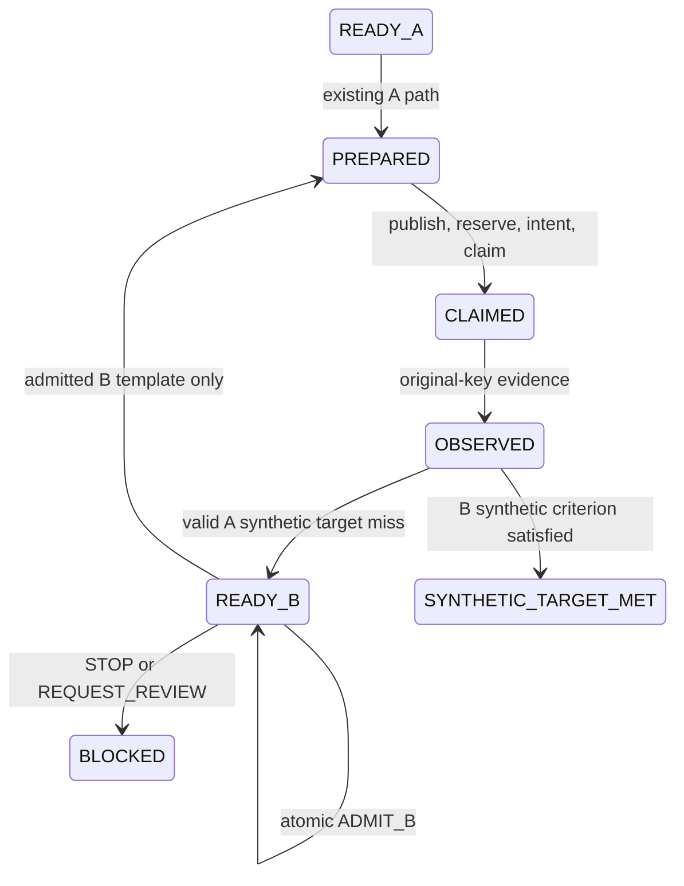

# M03-C: native Main proposal with deterministic admission

M03-C introduces a new `proposal-workflow-v1` definition for new synthetic Projects.
Only Candidate A is initially specified. Codex Main can propose a new B after reading
A's feedback. The existing WorkflowCoordinator admits or rejects the untrusted
proposal; its existing publication, budget, claim and execution boundaries remain
responsible for subsequent synthetic effects. There is no second Agent framework,
DAG, writable MCP tool, AF executor or automatic Turn initiator.

## Compatible extension, no historical migration

The original `synthetic-workflow-v1` retains its strict two-template schema and behavior.
`parse_definition` discriminates the new A-only variant. Neither old definitions nor
frozen Goal/Model/Verification bytes are rewritten. SQLite tables and Project metadata
schema remain unchanged; the existing `workflow-event-v1` gains an `ADMIT_B` action.
The reader replays it using the same pure workflow reducer and owned Project transaction.

This is backward read compatibility for existing data, not forward compatibility of
old binaries. An old program may reject the new definition/action and must not write
that Project. Existing fixed A/B Projects are not silently converted. Dynamic B is
possible only in an explicitly created new proposal workflow.

The product additions are `research/candidate_proposal.py` and `research/proposal_rules.py`.
The DTO belongs in the research layer because it reuses existing contract primitives;
the frozen dependency policy forbids contracts importing other package modules.
`workflow.py` and `workflow_rules.py` contain only the compatible admission/view glue.
All SQLite writes still belong to the unchanged `research/project.py` authority.

## ResearchBrief

`WorkflowCoordinator.research_brief()` is a bounded, read-only projection of one
validated Project snapshot. It requires a new proposal workflow at READY_B with one
valid A target-miss decision and no admitted proposal. It rechecks A's actual files
using Mutation Guard, current frozen bundle and ledger. It copies only explicit
typed fields; model prose, logs, local paths, credentials and unsupported evidence
fields are never copied into the view.

The brief includes challenge/Project/workflow/revision, four frozen digests, source
ID, A candidate/decision/evidence references, allowed parameter/range/unit/entity/step,
prohibited edits, current available/held/charged/unknown budget, A TEST_ORACLE metric,
objective/tolerance/hard constraints, completeness, V0–V4 limits and proposal budget.
The UTC read timestamp is informational. `brief_digest` covers the stable content
including Project revision, excluding that read timestamp. It is a consistency
digest, not a signature or author identity proof.

M03-C's synthetic fixture has no AF observations: `af_fake_refs=[]` is explicit.
Neither historical M03-B Fake runs nor their credentials are attached to a dynamic B.
Any future AF-reference projection requires its own exact binding and source review.

The supported scope is intentionally narrow: one load scalar, Beam.Tip NODE_SET,
Load/frame1/DOF1 and one declared evidence metric. The hypothesis is explicitly
SYNTHETIC_PROPORTIONALITY_ONLY. No hidden B value or future oracle output is placed
in a brief. One datum does not identify real mechanical behavior.

## Proposal schema and trust boundary

`CandidateProposal.from_bytes` accepts bounded strict JSON, at most 8192 bytes.
It rejects duplicate/unknown fields, floats/NaN/Infinity, unsupported actions,
noncanonical Decimal strings and unit/entity/step/parameter mismatches. Proposed
mutation is present only for PROPOSE_CANDIDATE; STOP and REQUEST_REVIEW carry null.
Identity/revision/brief/contract/A/decision/evidence references are mandatory.

Rationale, assumptions, uncertainty and reviewer findings are small plain-text data
fields. Their conservative grammar forbids paths, shell punctuation and known
instruction/authority phrases; no content is ever interpreted or executed. This
filter may reject harmless prose. It is defense in depth, not an NLP detector or OS
sandbox. A new authority field such as Grant approval, machine PASS or remaining
budget is not part of the schema and is rejected.

Exact original bytes are retained as bounded UTF-8 chunks with original SHA-256 in
the admission event. The reducer rejoins the chunks, verifies that hash and parses
the same bytes again. Canonical reserialization is not called the original output.
Any same-key different byte content, including a whitespace-altered capture after
admission, is a conflict. Safe local provenance is archived by the trusted test runner;
the product labels all captured proposal content UNTRUSTED_AGENT_OUTPUT.

## Same coordinator, atomic admission

`admit_proposal(raw)` opens an explicit write snapshot through the existing `_event`
path. It replays persisted contracts, A evidence/decision and ledger, checks exact
current revision and every binding, requires available budget and no UNKNOWN hold,
and derives B's identity from challenge plus original proposal digest. The existing
MutationRequest parser and parent policy verify its range/scope. Within that same
transaction the guard rechecks A, reads the immutable baseline, applies the typed
scalar edit in memory and independently compares all bytes. No B file is published
and no budget is reserved during admission.

ADMIT_B records the capture and deterministic admission result atomically with the
Project revision. Its reducer independently recomputes the expected admission during
every reopen. Agent self-reported PASS cannot replace that calculation. STOP/review
actions persist a human-review stop without an execution effect.

After admission the original definition remains A-only; the sealed admission stores
the derived B template separately. Subsequent PREPARE uses that template and the
current revision. Existing Mutation Guard, reservation, intent and CLAIM gates still
run; admission is not a resource guarantee or an external execution authorization.
The per-workflow B operation/business keys stay fixed even if proposals compete.
Only one content can win admission, and only a newly committed CLAIM can call accept.
Exact admitted-byte replay returns the existing state without writing or executing.

UNKNOWN, missing or contradictory A evidence, stale contract/revision, source drift,
exhausted budget and STORE_BUSY cannot authorize B. Journal/WAL/SHM guards are unchanged.
Injected hard exits before/after admission commit leave old/committed state or an
explicit STORE_BUSY stop. No journal is deleted or automatically repaired.

## Synthetic continuation

`tests/integration/m03c_support.py` is trusted fixture/ingress code. It never calls a
model, starts an AF Owner, or exposes a new public executor. Its ProportionalPort
subclasses the existing durable synthetic port: only the metric policy is replaced.
Default fixed-port behavior for M03-A/B stays unchanged.

Before any effects the fixture records a proportionality rule and derives its source
ID from that content. At acceptance, the rule digest must still match. It opens the
ResearchProject read-only, validates the published Candidate and digest, reads the
actual guarded scalar bytes, and evaluates the declared synthetic ratio using Decimal.
It does not return a fixed B response or calculate the proposal for Main.

The independent fixture database continues to count its own effect/receipt/call rows.
If the rule changes after admission, acceptance fails safely and the coordinator
keeps UNKNOWN with its held unit. This is not a distributed transaction or an adversarial
same-user tamper-proof system. Validating a proposal does not authenticate every future
external observation.

Native B is NOT_AF_EXECUTED. V2 remains NOT_RUN, V4 NOT_ASSESSED, physical eligibility
false, and real Goal INCONCLUSIVE even when a synthetic criterion is met.

## Actual native Main boundary

The operator explicitly started the current Codex Main turn. Main read two newly frozen
briefs, authored literal JSON proposals, and saved those exact bytes through its native
tool call. The fixture runner did not compute the proposed values or initiate another
model/SDK/app-server turn. A native independent reviewer read the same briefs/captures
and returned advisory findings. This uses the existing native delegation model described
in [OpenAI's subagent documentation](https://learn.chatgpt.com/docs/agent-configuration/subagents).

The actual evidence combines the conversation's native Main/tool events, saved JSON,
hash/time/thread provenance, and before/after Project/ledger/effect snapshots. Files
and hashes alone do not authenticate their author. The demonstration is implementation
aware and occurs within one operator-started turn; it is not a blinded benchmark,
fresh independent session or automatic protected-state handoff. No claim of automatic
original-desktop Main continuation is made.

The trusted runner parses the exact captured file only when explicitly invoked.
Capacity/refusal/malformed/missing output returns AGENT_PROPOSAL_UNAVAILABLE without
new state or effects. Semantically valid but inadmissible proposals are rejected by
the deterministic gate. There is no model retry loop. Brief one-turn budget is a
declared interaction constraint, not a newly implemented provider quota mechanism.

## Next review boundary

A next gated ingress experiment may bind an externally captured Main artifact to an
operator-selected current Project and display its proposed mutation before admission,
with the same replay/unknown rules. It must still separate proposal provenance from
machine authority. M03-E automatic Turn resumption needs separate explicit approval,
ownership and duplicate-turn tests. Neither feature is implemented here; no dynamic
AF Plan/Grant preparation or Solver integration follows from this milestone.
