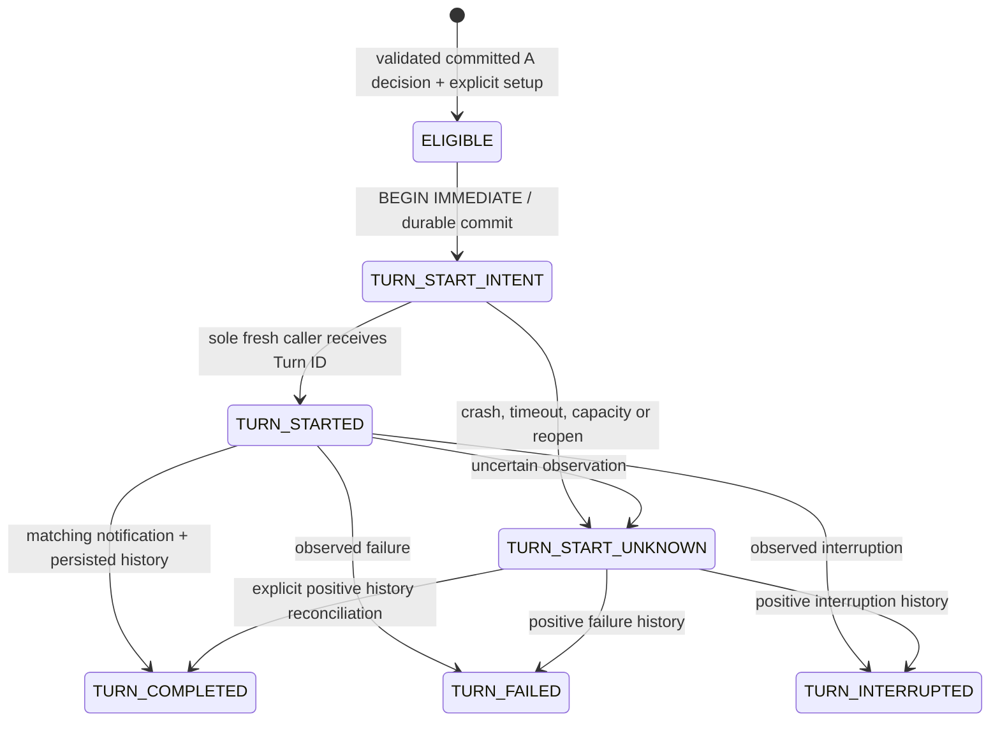

# M03-E1: controlled event-to-owned-Codex-thread continuation

This bounded experiment keeps Codex as the only Agent harness. GD-CAE validates a
committed synthetic decision and records a single dispatch intent; an explicitly
started **test-only** STDIO adapter owns the Codex process. There is no daemon,
filesystem watcher, scheduler, general RPC proxy, new MCP tool or research executor.

## Authority and source

`continuation.observe` reconstructs the existing Project audit and Workflow reducer,
revalidates the frozen bundle and actual Candidate A bytes, and obtains the existing
bounded ResearchBrief. The last committed source must be `WORKFLOW_RECORDED/DECIDE`.
For this proposal workflow the actual A-miss reason is
`VALID_SYNTHETIC_TARGET_MISS`, leaving `READY_B`; `SYNTHETIC_TARGET_UNMET` is a
different, terminal, two-step outcome. No log parsing or model-generated event is used.

`ContinuationEvent` contains canonical immutable bytes. Its SHA-256 key covers the
Project and storage generation, filesystem identity binding, revision, Workflow,
step A, Candidate identity/input digest, frozen digest set, source sequence,
transaction/time/digest, evidence references and sanitized Brief. The same full
envelope is reconstructed inside the source read transaction before dispatch.
Free-form assumptions/logs are excluded from the prompt. New fields or altered
values do not match the authoritative projection.

The exact `ContinuationPolicy` binds one owner UUID, thread UUID, verified CLI build,
configuration digest and explicit seed Turn ID. It expires within one hour and
allows at most one event Turn, `TEST_SYNTHETIC`, no tools, no execution or approval.
`requires_real_v2` and `requires_real_v4` must both be false. A policy demanding real
verification or AF scope is rejected.

**Scientific contract separation:** existing frozen scientific contracts can require
V2/V4 for eventual scientific acceptance. Those requirements remain unmet. This
policy permits only a read-only synthetic acknowledgement, not progression through
a scientific verification gate. E1-15 is interpreted with that explicit limitation;
the experiment cannot pass a literal requirement to forbid *all* acknowledgements
whenever the scientific contract requires future V2/V4. No frozen schema is changed.

## Storage and transitions

`continuation-outbox-v1.sqlite3` is an explicitly initialized, fixed-name, exclusive
Project-owned sidecar. Main `research.sqlite3`, frozen contracts and historical bytes
are not migrated or rewritten. This is a forward-only v1 extension; unsupported
schema, existing sidecar, wrong file identity, journal/WAL/SHM or corruption blocks.
There is no automatic repair, replacement, cleanup or upgrade path.

The one table is a bounded, hash-linked append-only journal with sequence,
transaction UUID, UTC time, kind and structured data. Readback validates schema,
chain, monotonically ordered timestamps, state transitions and semantic identities.
SHA-256/time are integrity/audit aids, **not signatures, trusted time or protection
against a malicious same-user editor**. A coherent rewrite/deletion by that user is
outside this application boundary; this is not cross-system exactly-once.

| Boundary | Behaviour |
|---|---|
| Source observation/setup | Read authoritative state; exclusive sidecar creation is trusted setup |
| Claim | SQLite `BEGIN IMMEDIATE`; one committed intent, at most one intentional attempt |
| Before send | Recheck owned idle thread/config/auth, expiry; intent already committed |
| Crash before intent commit | Clean rollback can leave ELIGIBLE; hard-exit journal blocks |
| Crash after intent commit | Reopen presents UNKNOWN, even if transport was never called |
| Lost reply/capacity/error | UNKNOWN, no resend, no substitute thread, no budget refund |
| Duplicate delivery | Returns persisted receipt, without preflight or `turn/start` |
| Completion | Exact thread and Turn; one added history entry; full input digest; no tools; qualified output |
| Reconciliation | Read only the recorded thread; unique exact match can record terminal proof |
| Missing/ambiguous history | Remains UNKNOWN; absence does not prove non-acceptance |

The source Project read transaction is held for the bounded dispatch/observation.
That prevents a concurrent Project writer from committing a conflicting revision;
it can temporarily block writers and is deliberately unsuitable for a long-running
production service. The sidecar lock is released after durable intent. An existing
intent is never dispatchable. Local append failure after remote success still
blocks subsequent dispatch; explicit reconciliation is required.

`ContinuationReceipt` includes key, thread, observed Turn ID, persisted/effective
phase, exact input digest, CLI build, normalized history and proof source. Terminal
proof is replayed semantically, including output evidence references and
`NOT_ABAQUS_QUALIFIED`. A JSON-RPC request ID provides transport correlation only.

## Test-only protocol boundary

Product modules contain no subprocess or Codex SDK dependency. `CodexTurnPort` has
only `preflight`, `history`, `start_turn` and `terminal`. The trusted test adapter
uses an installed, version-checked `codex.exe`, STDIO and retained process handles.
The adapter is not pytest-auto-run and rejects Python optimization mode.

Installed build: `0.165.0-alpha.1.2`. Stable schema was generated locally without
enabling experimental APIs. Fresh empty CODEX_HOME had no authentication; the
authorized fallback used existing authentication without copying credentials or
modifying configuration. Only newly created, recorded test thread IDs were read.

Per-process configuration disables shell/unified execution, apps/plugins, multi-agent,
hooks, computer use, skill/tool suggestion, web, notifications and configured MCP.
Readonly/no-network sandbox and approval `never` are checked. A disabled MCP can
still be listed: only the known `node_repl`, `runtimeStatus=disabled`, no tools,
resources/templates/errors and no pagination is accepted. Listing is not activation.
Stable installed schema does not support narrowed read roots; the empty test cwd is
used, but readonly same-user access is **not** an OS/cryptographic isolation claim.

An empty `thread/start` was readable in-process but had no durable rollout and could
not resume. The separate, actual persistent test thread received one explicit seed;
after graceful shutdown, its seed/history could be resumed and read in a new process.
No second seed or replacement persistent thread is permitted. The event smoke uses
exclusive launch and dispatch marker files in addition to the durable Outbox.

The adapter reconstructs input digests from complete raw `userMessage` text and
counts unknown history item types conservatively as tools. It checks real
`turn/completed` notifications separately from persisted history. Metadata such as
`originator=Codex Desktop` or `source=vscode` in an inherited CLI environment does
not establish visibility or mutation of the user's existing Desktop conversation.

## M03-E2 feasibility proposal only

Keep E1's owned-thread result separate from original Desktop Main attachment. A
future, separately approved research phase should first establish documented API
ownership, session visibility, concurrent active-turn handling, and Desktop refresh
behaviour on the installed version. Prefer a disposable Desktop-visible test thread;
never infer the target from recency or edit session indexes/rollouts. Define an
explicit test owner, one-turn budget, expected UI and protocol observations, and
STOP on unknown ownership, auth/config changes, missing history or ambiguous UI.
Even a visible CLI-created thread does not prove safe continuation of the current
development Main. E2 must not add execution, AF or budget authority. No E2 code,
automation, app-server daemon or current-Main mutation was implemented here.

Sources checked for capability context (local probe controls the actual conclusion):
[official App Server documentation](https://learn.chatgpt.com/docs/app-server),
[Codex issue 33650](https://github.com/openai/codex/issues/33650),
[30916](https://github.com/openai/codex/issues/30916),
[21743](https://github.com/openai/codex/issues/21743).
Issue reports are historical evidence of possible integration gaps, not proof that
the locally installed build has those bugs. Runtime results and acceptance limits
are recorded separately in `docs/milestones/M03-E1_DELIVERY_REPORT.md`.
