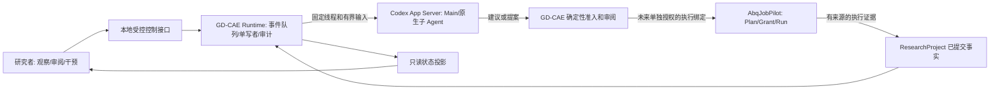
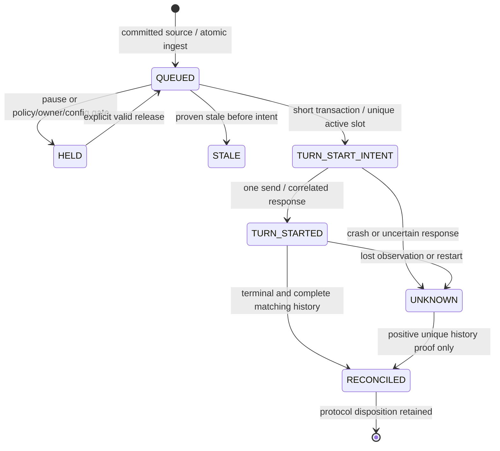

# M03-F0 — Persistent Codex Main Runtime Architecture

日期：2026-10-29。状态：**DESIGN_REVIEW_ONLY**；首选方向已由用户确认，具体实现待审批。
基线：`main@538bfae9a3a5fcea97970b9effc4f1f168490650`。

## 1. 决定、范围与证据等级

采用 **GD-CAE-owned persistent CLI/App Server Main**：GD-CAE 负责有界事件交付、
持久控制与审计；Codex 保持唯一 Agent Harness；AbqJobPilot 保持唯一获准的 Abaqus
执行所有者。长期存在的是科研身份、线程绑定和可恢复记录，不要求进程永不退出。
本方案不复制 Codex 的推理循环、子 Agent 调度或上下文管理，也不新增通用 DAG。

M03-E2B 的 `M03E2B_BLOCKED_UNSAFE_TEST_CONFIGURATION` 保留为真实历史结论。
其测试标识已私有保存，但不再尝试向该 Desktop 线程发送外部 Turn；不要求用户
继续人工操作，不抢锁、不改全局配置、不复用原开发 Main。本报告不是解除 E2B
门槛的补丁。以后 Runtime 使用全新、明确归属的 CLI 线程及独立批准的配置方案。

本轮只新增本文。未运行 Python、pytest、Ruff、App Server、AF Owner、Abaqus 或
任何模型 Turn；没有安装、修改生产源码/历史报告、提交或推送。官方资料查询与
仓库只读核查不构成新运行验证。下文所有新表、接口、状态机和验收均为 **PROPOSED**。

本次核查的本地依据：

| 依据 | 当前可支持的结论 |
|---|---|
| [E1 交付报告](../milestones/M03-E1_DELIVERY_REPORT.md) | HISTORICAL_EVIDENCE：一个自有线程真实事件续 Turn、独立进程历史读取、重复事件无新增 start；本轮未重跑 |
| [continuation.py](../../src/aegiscae/research/continuation.py) | SOURCE_VERIFIED：可信 source 重建、提交 intent 后唯一新调用栈发送、UNKNOWN 无自动重试、正向历史对账 |
| [continuation_rules.py](../../src/aegiscae/research/continuation_rules.py) | SOURCE_VERIFIED：scope TEST_SYNTHETIC、max_turns=1、最长一小时、baseline 1/完整历史 2、无工具/执行权 |
| [continuation_store.py](../../src/aegiscae/research/continuation_store.py) | SOURCE_VERIFIED：固定 v1 sidecar、严格 schema、最多 8 条 journal、1 MiB 文件上限、journal/WAL/SHM 存在则阻断 |
| [E1 protocol test adapter](../../tests/integration/m03e1_protocol.py) | SOURCE_VERIFIED：版本绑定、STDIO、自有进程句柄；含全量 config/account 查询、单页历史与测试目录断言，不是可直接部署的服务 |
| [E1 单元测试](../../tests/unit/test_continuation.py) | SOURCE_VERIFIED：丢回应、硬退出、独立进程竞争/重开及损坏用例存在；本轮未执行 |
| [E2A](../milestones/M03-E2A_DESKTOP_COMPATIBILITY_AUDIT.md)、[E2B](../milestones/M03-E2B_DESKTOP_INTEROP_DELIVERY_REPORT.md) | 历史版本/静态限制与安全停止，不是 Desktop 同步、排他租约或长期 Runtime PASS |
| [ADR-003](../adr/ADR-003-codex-native-delegated-execution.md)、[ADR-004](../adr/ADR-004-execution-evidence-research-verification.md) | 权限和科学证据的权威分离；原文件保持不变 |

E1 历史报告记录 703 passed / 21 skipped 和 Ruff 通过；不是 F0 的测试结果。
E1-15 合成 ACK 仅表示读到指定证据，不满足真实 V2/V4，不授予科学推进或执行权限。
历史观测 CLI 为 `0.165.0-alpha.1.2`，Desktop 为 `26.1023.51421` build `22530`。
F0 没有重测版本；下一施工阶段必须重新测量并绑定可执行文件及 schema。

官方 [App Server 文档](https://learn.chatgpt.com/docs/app-server) 本轮已搜索并打开：
每次连接初始化后可新建/恢复线程、发起 Turn、接收终态；thread/read 和分页历史
读取与 thread/resume 有不同语义。恢复可能取得可写所有权，不当作只读操作。
本地版本/schema 及实测控制兼容结论；官方接口存在不证明跨客户端排他或幂等。

## 2. 三方边界与最小模块

图中 AF 执行连接与提案集成是后续设计方向；下一最小实现仅启用无工具 ACK。

| 所有者 | 允许拥有 | 必须不拥有 |
|---|---|---|
| 人类研究者 | 科研范围、合同/预算批准、服务启停及人工审阅；身份和授权来源可审计 | 不能用聊天中的模型自报替代本人动作；取消不证明远端从未执行 |
| GD-CAE 研究域 | 既有 Project、合同、Mutation Guard、BudgetLedger、Workflow、准入和有来源的检查 | AF Grant 签发、Abaqus 启动、修改 AF 私有数据库、把 ACK 写成科学 PASS |
| GD-CAE Runtime | 自有 Codex 子进程生命周期、固定线程绑定、队列/intent/只读对账、人类控制记录 | 通用 RPC/命令转发、任意线程寻址、AF 生命周期、绕开 BudgetLedger 或准入 |
| Codex App Server/Main | 原生推理、历史、原生子 Agent；输出不可信建议 | 冻结合同变更、研究授权、预算自增、直接运行 Solver；App Server 本身不代表 GD-CAE 科研权威 |
| AbqJobPilot | 经独立授权的 Plan/Grant/Receipt/Run 和执行事实 | 将执行完成自动升级为目标满足或物理有效 |

最小新增实现责任建议（名称待施工批准，不在 F0 创建）：

| 模块 | 单一责任与依赖 |
|---|---|
| runtime_records / runtime_store | 严格 DTO、独立版本 sidecar、短事务、CAS、唯一约束、审计重放；无远程调用 |
| runtime_coordinator | 入队、状态转换、单事件派发与对账；依赖只读 Project 投影和窄 TurnPort |
| codex_owned_port | 安装版本兼容、STDIO 分帧、固定线程、进程句柄/退出证据；唯一 Codex 进程边界 |
| runtime_control | 只读 status/evidence 与有身份的 pause/drain/resume/interrupt 请求；同一队列仲裁 |

四个责任域可在首版合并少量文件，不建设微服务集群或通用 Agent 框架。
只准固定方法枚举，无用户传入 method/path/SQL/命令。七个 AF 读取工具和两个
proposal-only 工具保持既有语义；[M03-D](M03_PROPOSAL_INGRESS_AND_REVIEW.md) 的
Receipt、AdmissionDecision、ReviewDecision 与 AF Grant 继续分立。

## 3. 生命周期、线程绑定与配置门槛

单机、单 Project、单 Main 线程、单出站写客户端为第一版范围；不支持 HA/多主。
RuntimeBinding 记录 runtime_id、Project 身份/存储 generation、明确状态根、workspace
身份、线程 ID、seed Turn ID、协议/schema 指纹、CLI 版本/文件摘要、模型、配置证据
摘要和 policy_id。原始 ID/路径仅在受限私有存储，面向用户的普通视图用别名。
绑定不从 Recent、文件时间或会话索引推断，不将 Desktop 线程注册为 Runtime-owned。

1. 显式 bootstrap：先持久 CREATE_THREAD_INTENT，再最多一次 thread/start。
   响应丢失则 CREATE_UNKNOWN，停止；不扫线程列表找“最像”的结果，不自动另建。
2. 记录返回身份后，显式、单独计数的 seed 也须 intent。E1 已观察到无 seed 的空
   线程未必可持久恢复；必须验证 seed 完成和重新读取后才标为 THREAD_READY。
   seed 丢回应也只对账，不重发。创建、seed 与业务事件各自有固定配额和记录。
3. 正常接管自己的已知线程前，先取得本地独占所有权、核对旧进程已退出、只读
   检查绑定/历史，再决定是否 resume。发现 active、外部新增 Turn、配置漂移或未知
   所有权均暂停；不试图以 resume 的拒绝作为抢占测试。
4. 服务退出后可按同一绑定启动新进程；同一 thread/session 的可重开不等于重新
   发送未决事件。无故换线程、fork、清空历史、自动 compact/revert 都不在首版。
5. 线程历史达到限制时进入 REVIEW_REQUIRED，保留旧记录。未来如需轮换，必须
   独立设计显式 lineage/摘要校验/审批，不为绕开 UNKNOWN 轮换。

**配置阻断不会因选择 CLI 而自动消失。** E1 在当时授权下用已认证 HOME 并读取
全量 config/account；E2B 的更窄权限不能支持该路线。不得把 E1 adapter 原封不动
放入生产，也不得把进程参数、空 cwd 或 prompt 当成有效能力证明。

下一阶段先做配置可行性门：明确批准的专用 Runtime 状态/配置/认证安排；优先
独立状态根且不复制现有凭据。若需要登录、认证配置或超出现有范围的配置读取，
应把精确字段、存储位置与人工准备步骤单列审批，不能默认获准。无认证则 BLOCKED，
不退回共享 HOME。使用已有认证的任何替代方案也要独立审查，不能暗自回退。

首版策略：无工具、只读 sandbox、工具网络禁用、无 shell/MCP/hooks/web/插件，
拒绝意外的 server request。approval=never 不等于禁用工具；工具禁用须有版本
支持的有效配置/能力证据。配置本身可能含 provider/身份；全量读取后过滤不叫
避免读取。安全限定查询或经批准的专用配置验证都不成立时，真实 smoke 停止。
模型服务通信与工具网络权限分开，不声称“模型运行无需网络”。不得自动换模型
绕容量不足；版本升级/配置变更使 READY 失效，重新预检和审阅。

## 4. 单写者与故障边界

主机制是 OS 支持的本地独占锁/受限 IPC 所有权，加持久 owner_generation 和
retained child handle。SQLite owner 记录包含实例 nonce、启动时间、generation、
子进程身份、退出观察；PID 单独不足以识别进程。heartbeat 只显示活性，过期不
授予接管。owner_generation 只能约束 GD-CAE 写入，App Server 不识别它，故不能
称为远端 fencing token。

所有 turn/start 都必须经过持锁的唯一发送者；同一线程最多一个 unresolved intent。
本地多个 Agent 只能向队列提交相同类型的候选事件，不能持有 App Server stdin。
观察端不启动第二个写客户端，人工文本输入也走 Runtime 仲裁，不从另一 CLI
直接 resume。未授权外部客户端仍可能在同用户上下文访问线程，应用锁无法防御；
部署隔离是独立要求，不宣称敌对同用户安全。

旧 owner 崩溃后：即使 OS 锁已释放，若旧子进程存活或无法证明其归属/退出，状态
为 OWNER_UNKNOWN，不启动新的发送者。拟议 Windows Job Object kill-on-close 等
子进程约束需后续实测；未验证时只能人工审阅。不得按进程名杀全局进程，不删
锁文件解锁；只允许关闭自己保留的已核验句柄。子进程已退出也不证明远端 Turn
没被接受，必须继续 UNKNOWN 对账。第一版不提供自动故障转移或看门狗重发。

## 5. 持久数据与事务边界

拟议独立 `main-runtime-v1.sqlite3`，显式创建，不覆盖/迁移
`continuation-outbox-v1.sqlite3`、proposal sidecar、ResearchProject 或冻结合同。
unsupported schema、身份不符、残留 journal/不完整初始化直接阻断。首版沿用
保守 journal 拒绝；WAL、多读取者和自动恢复另行设计。损坏后不自动新建空库替代。

| 记录 | 最小字段与不变量 |
|---|---|
| RuntimeBinding | 上节绑定；scope TEST_SYNTHETIC_ACK、execution_authorized=false；不含凭据 |
| SourceCursor | project/generation/stream、最后确认 source sequence/digest；只与入队事务共同前进 |
| EventInbox | source identity/sequence/transaction/digest、immutable payload、合同/证据引用、捕获 revision、arrival_seq |
| Dispatch | event key、intent_id、owner_generation、policy/config digest、exact input digest、baseline history proof、attempt_limit=1、Turn ID/phase |
| Observation | 连接/观测编号、原始证据私有引用、标准化历史/terminal、完整性与分页范围、观测时间、verdict |
| Control/Review | operator provenance、command_id、expected runtime revision、请求/生效状态、reason、目标事件/Turn、策略版本 |
| RuntimeAudit | 单调 sequence、transaction_id、UTC、前项摘要、transition 与对象引用；重放校验 |

event identity 使用 Project+generation+source_stream+source_sequence+event_type。
该身份下重复 envelope 完全相同则返回原记录；相同身份但内容/digest 不同为冲突，
不能单靠 payload hash 生成新 key 绕过重复保护。JSON-RPC id 和 clientUserMessageId
不被当作远端幂等承诺。所有记录有大小、条数和严格字段上限，预算缺省不能无限。

Project 与 Runtime 不共享原子事务：在短只读快照中检查 committed source、合同、
实际模型摘要及有界 Brief；在 Runtime 事务内 INSERT OR 检查相同 source 并推进
cursor。读取后入队前崩溃则重读；入队后确认丢失则唯一约束返回原项。定期有界
扫描**该明确 Project 的已提交审计**补事件，不扫描文件日志/私有会话；不订阅 LLM
文本当触发源。序列缺口/摘要矛盾/来源不完整不跳过，进入 SOURCE_GAP/BLOCKED。

与 E1 的重要区别：事件快照应可按历史 revision 重建和校验，不要求永远等于当前
最新 DECIDE；历史 receipt/reconcile 不因 Project 前进自动失效。当前准入单独
检查 freshness；若 source/artifact 无法再验证，则保留协议观测但不允许科研推进。
不能将 E1 的 _source/_read 改成跳过校验；需新版本投影和针对 revision 前进的测试。

首版队列 FIFO（以源序列及本地 arrival_seq 定序），不自动合并事件；乱序有界等待，
重复不占第二配额。队列满返回明确 BACKPRESSURE，不先推进 cursor 或丢掉事件。
已证明过时且尚无 intent 的事件可有理由地标记 STALE；有 intent 后不可这样消账。
原始保留证据不能按队列上限自动删除。磁盘满时不接收新 intent、不发送，留下告警。

## 6. 派发、幂等与 UNKNOWN 对账

RECONCILED 保存 completed/failed/interrupted，另有 output_valid=true/false；协议
完成与语义合格分开。错误输出或工具活动仍能证明某 Turn 已发生，但使 Runtime
进入 REVIEW_REQUIRED，绝不触发提案准入或下一步科研执行。未证明不计成功。

派发步骤：

1. 唯一发送者校验 owner、策略期限、队列头、源和当前 revision、能力证据、历史
   完整性与 idle。历史必须与记录的 seed 加已对账 Turns 一致；外部插入即阻断。
2. 在短 SQLite 事务中 CAS runtime revision，检查无其他 active/UNKNOWN，预占本轮
   Turn 配额，保存 exact input/template/schema digest、完整历史基线和 intent；提交。
3. 仅刚成功提交的调用栈可在本地发送锁内再次核对暂停/所有权/期限后尝试一次
   turn/start。重开读到 intent 一律 UNKNOWN；第二预检失败也不自动释放 intent。
4. 等待远端期间不持有 Project/Runtime 长事务。通知是观察信号，不直接更新科学
   结论。短事务记录响应、Turn ID、终态与历史证明，严格匹配线程/输入/事件身份。
5. 只有协议 completed 终态唯一核验、output_valid=true、状态落盘、无 REVIEW_REQUIRED
   且策略/配额/owner 门仍通过，才允许后续 ACK 事件。failed/interrupted 必须先审阅。
   若 Project 已变，ACK 可归属旧快照，
   但任何提案/科研动作必须以最新 revision、冻结合同、证据和预算重新确定性准入。

Project revision 在预检与远端发送之间仍可能变化，短事务不能消除该竞态。
首版只读 ACK 因而明确采用“解释某个已提交快照”的语义，**不承诺发送时仍是最新**。
对需要当前状态的写操作，必须走既有 Workflow CAS，不靠 Runtime intent 保证。
源事务、Runtime SQLite 与 App Server 之间不存在分布式事务。

UNKNOWN 对账只读取固定线程和有界分页历史，匹配 baseline 后的唯一新 Turn、完整
user input 摘要/事件绑定、Turn ID（已知时必须相同）、状态和 item 类型；不以时间
相近或文本含 ACK 为依据。读到 inProgress 保持占用；缺页、重复游标、同一页内
矛盾、多个匹配或身份不符停止。工具活动可以留下唯一匹配的已发生协议事实，
但必置 REVIEW_REQUIRED，不自动结束安全审阅或放行后继。分页上限耗尽是
INCOMPLETE，不是空历史。
采集开始/结束边界和既有序列摘要一致才视作完整；变化中重读只能限次且无写入。

正向匹配可消解为已完成/失败/中断；缺失匹配、超时、模型容量错误、socket 关闭、
本地 intent 已提交但尚未发送的崩溃，都不能证明远端没接受。不得自动重发、退款、
改 key 或换线程。每个事件最多一个有意发送尝试，不能宣称远端 exactly-once。
只读对账可限次退避；到达时间/次数上限转人工审阅，UNKNOWN 仍持久存在并阻挡该
线程派发。人工可以暂停/封存调查，不能将 UNKNOWN 点成“未执行”释放配额。

Turn 配额与 BudgetLedger 的 AF/科研预算分开。首版记录 seed、事件 start 尝试上限、
队列/读重试/墙钟上限，UNKNOWN 不释放已预占配额；不是准确 token/费用上限。
真实用量不可见时显示 UNKNOWN，不猜账单；不得修改现有 BudgetLedger 消除 Codex
容量失败，更不能把有剩余 Turn 配额解释为 AF Grant。

## 7. 人类观察、审阅与干预

不依赖 Desktop 同步。首版提供本地命令行或 JSON/文本状态投影，输入只接受预绑定
runtime_id 与固定命令，不接受任意 thread ID。后续 UI 可消费同一投影，不直连
App Server 写端口。只读观察不能隐式创建库、resume 线程或派发队列。

| 接口（拟议） | 行为与完成含义 |
|---|---|
| status / events / evidence | 显示 owner、最后已核验 Turn、queue/UNKNOWN、观测时间、连接新鲜度、阻断原因；证据按 scope 分开 |
| request_pause | 持久停止新派发；不声称打断正在运行的 Turn |
| request_drain_stop | 停止取新事件，已运行项限时观察/对账，记录未决项并关闭自有句柄 |
| request_interrupt | 精确固定 Turn，显式人类动作和 intent；仅后续批准且验证的窄 turn/interrupt；返回接受不代表已经终止 |
| request_resume | 仅重新打开本地 dispatch gate，需重新预检；不会重发 UNKNOWN，也不是随意 thread/resume |
| review / enqueue_note | 审阅意见独立留痕；文本视为不可信数据，若未来进入 Main 输入也按事件排队，不能 steer 活跃 Turn |

所有控制请求携带 command_id、expected runtime revision、对象和身份来源；同键
同内容返回旧结果，异内容冲突。只读观察与人类写控制分别授权；Main/子 Agent 不
具有操作者控制凭据。单用户 OS 身份只能提供有限归属，不宣称独立个人不可抵赖。
真正人工批准合同/提案仍须相应独立授权模型；“resume Runtime”不等于批准研究。

pause 与发送共享同一短临界区：暂停 ACK 要列明生效 revision 和已经取得发送权的
intent。若发送先赢，显示该 Turn 已在途；若暂停先赢则不得开始发送。发送锁覆盖
最终检查到有界写入，不能一边回报“已暂停”一边发新输入。崩溃窗口仍归 UNKNOWN。
首版可以只实现 pause/drain/resume，interrupt 保持禁用并显示 NOT_IMPLEMENTED。
未来 interrupt 的丢回应和重复调用需独立试验，不自动重复 RPC。

观察界面并列：事件已接收、intent 已提交、Turn 已观察、协议终态、提案 receipt、
准入/审阅、AF receipt/run、V0–V4。没有证据的格子显示 NOT_RUN/NOT_ASSESSED/UNKNOWN。
断线时展示“截至某观测”的历史，不能显示实时健康绿色。模型文本只作为建议；
无工具 ACK 中出现 RECOMMEND_NEXT 也不会自动执行 Candidate B。

## 8. 异常退出与恢复顺序

| 故障位置 | 必须行为 |
|---|---|
| source 捕获/入队提交前后 | 按持久 cursor 重读；唯一身份去重；禁止丢 source 或双队列项 |
| intent 提交前 | 未获派发权，不调用远端；正常回滚可稍后重新检查资格 |
| intent 提交后任意位置 | 新进程一律 UNKNOWN，不凭本地未记发送就再发 |
| 远端成功、本地保存失败 | 保留已提交 intent；只读历史对账，禁止新的 start |
| 运行中父进程/机器异常退出 | 先 owner/进程检查，再校验存储，再 targeted history；不自动抢占 |
| 失败/中断终态 | 不是科学 PASS；保留尝试占用，人工审阅后才决定另一个合法事件，禁止自动同事件重试 |
| journal、磁盘满、库损坏、身份错位 | BLOCKED_STORE；保留证据，不删除 journal/重建库/迁移历史 |
| CLI/模型/config/auth 漂移或到期 | BLOCKED_CAPABILITY；禁止静默换版本、模型、认证或全局配置 |
| 时钟回退或策略有效期无法证明 | 暂停；UTC 用于审计，单调时钟用于进程内 deadline；不据 TTL 自动转移所有权 |

安全恢复顺序固定为：验证文件与绑定 → 取得本地独占权且证明旧子进程退出 →
存储重放与 capability preflight → 对账所有未决项 → 核对历史边界 → 人类恢复 gate。
若远端未知状态仍在，保持暂停。计划停机先 drain；不清理历史材料。没有后台
Windows Service、任务计划、开机自启或无人值守启动授权；首个实现由操作者显式运行。

## 9. 复用清单与尚缺的真实验证

| 能力 | 复用方式 | 尚缺证据/改造 |
|---|---|---|
| E1 source/canonical DTO/输入约束 | 复用校验思想、既有历史 Brief 投影和公共校验函数 | 新多事件 envelope；旧事件在 revision 前进后的可核验性 |
| E1 intent-before-send、UNKNOWN | 保留语义与故障用例 | 多事件队列、创建/seed intent、跨进程恢复的统一实现 |
| E1 同事件重复与并发 claim | 复用正负测试模式 | 长驻 owner、进程孤儿/暂停竞态、队列 cursor 的独立进程测试 |
| E1 正向历史匹配 | 保留完整输入与身份匹配要求 | 不再固定 len=2；分页、历史增长、外部插入和截断检测 |
| E1 STDIO/关闭自有 handle | 作为 test adapter 参考 | 有界队列/帧/日志、意外server请求拒绝、独立配置证明、服务模块边界 |
| E1 v1 sidecar | 原样保留可读；新 Runtime 不接管/覆盖 | 新 store 明确版本、无隐式迁移、独立额度和只读观察 |
| M03-D 提案及 gate | 后续可复用严格 DTO/确定性准入 | 长期 Main 实际 MCP 提案、独立审阅和端到端控制尚未联通 |
| 原生专业子 Agent | 后续继续使用 Codex 原生委派 | E1 禁用了 multi_agent；不能把其 ACK smoke 当作专业子Agent长期运行证据 |
| AF 集成 | 保留既有有来源读取/TEST证据边界 | Runtime 到 AF 的完整闭环、真实授权/执行、V2/V4 均不在本阶段 |

## 10. 下一阶段最小施工计划（待独立批准）

建议 **M03-F1 — Bounded Persistent ACK Runtime**，只做单 Project、一个新 CLI
线程、一个 seed、最多两个不同可信合成事件的顺序 ACK；不接 proposal、AF、真实
模型或科研预算。两个事件内容可由可信合成 fixture 准备，不能用模型自报当事实。

| 阶段 | 产物与退出门 |
|---|---|
| F1-G0 能力/授权门 | 精确配置与认证方案、安装版本/schema、状态根/线程归属、配额和进程收尾方案；无安全证明则只完成离线部分，真实阶段 BLOCKED |
| F1-G1 离线核心 | 新版 store/单写者 coordinator/只读控制投影及测试 doubles；完整负向矩阵，保持冻结/v1 bytes 和架构守卫 |
| F1-G2 窄 adapter | 仅批准的自有 CLI 生命周期和固定 RPC；不得从测试复制全量私密配置读取；有界帧/历史/错误，优化模式不可绕过守卫 |
| F1-G3 受控真实 smoke | 另行批准的 bootstrap/seed；事件1完成，关闭并证明进程退出；新进程恢复同线程，事件2完成；每个事件重复交付零新增start；最终独立只读验证 seed+2 |
| F1-G4 交付 | 全部适用无Solver回归/Ruff/diff、独立Reviewer、原始私有证据和退出证明；分别报告离线/配置/真实续Turn/恢复结果，停止 |

最低可执行版本无需常驻 daemon、网络监听或新依赖；显式前台运行至配额/暂停即退出。
真实 smoke 不做故意并发写、不制造第二次真实 UNKNOWN 请求；丢回应/崩溃/乱序
先用受控 doubles/独立进程故障注入。真实模型 capacity failure 若发生按原路径
停止，对账而不自动重试；报告 PARTIAL。单次关闭/恢复成功也不等于长期稳定性。
后续才考虑长时间 soak、原生委派、proposal-only 集成与 AF 事件接入，各自独立审批。

## 11. F1 拟议验收矩阵

下列全部为 **NOT_RUN_IN_F0**；不得把设计覆盖写成实现 PASS。

| ID | 必须观察的断言 | 最低验证方式 |
|---|---|---|
| F1-01 | 版本/schema/auth/工具权限来源可证明，不安全即0start | 静态+独立批准的实际预检；负向配置用例 |
| F1-02 | 新CLI绑定唯一；创建/seed丢回应不另建不重发 | 离线故障；实际seed持久读取 |
| F1-03 | 新sidecar不改变Project、冻结合同、E1/D旧库 | 前后bytes/身份比较，旧reader重开 |
| F1-04 | EventInbox入队/cursor同一Runtime事务；重复不丢不双计；内容冲突拒绝 | 提交前后硬退出、两进程竞争 |
| F1-05 | 源序列缺口/乱序/队列满有界停止且不跳cursor | 合成负向/背压用例 |
| F1-06 | 一次intent提交先于唯一start | port观测持久库；故障注入每个边界 |
| F1-07 | 多owner争用只有一个发送者；TTL不授予接管 | 两进程+挂起旧owner、PID复用模拟 |
| F1-08 | 孤儿子进程/未知writer阻断，无全局kill/抢锁 | 仅自有无害测试子进程；进程归属证据 |
| F1-09 | 远端已接受但本地丢回应/终态仍不再发 | doubles、fresh-process reopen，attempt=1 |
| F1-10 | UNKNOWN唯一正向历史可消解；缺失不等于没发 | 已知/未知Turn、错摘要、多个匹配、分页缺口 |
| F1-11 | 多事件历史增长后可读旧receipt并对账 | revision推进、两个不同事件、历史前缀校验 |
| F1-12 | 等待远端不持Project长事务；过时输出无准入权 | 阻塞port同时独立Project写事务；CAS负向 |
| F1-13 | pause与send竞态线性化，ACK准确列在途intent | 并发barrier与进程中断；两种顺序 |
| F1-14 | 控制接口幂等且只对固定Runtime；Agent无控制权 | 伪operator/错revision/错对象/恶意文本 |
| F1-15 | disk/journal/损坏/时钟回退保留材料并停止 | 隔离合成store故障；无自动修复 |
| F1-16 | 协议完成、输出合格、科学验证分开 | 无效JSON/工具item/伪PASS；V2/V4仍未满足 |
| F1-17 | Turn配额与科研预算隔离，UNKNOWN不释放 | 配额耗尽/重放；BudgetLedger前后不变 |
| F1-18 | 真实同线程seed+2；重复交付零附加start | 批准后App Server原始响应/terminal/完整历史 |
| F1-19 | 退出后新客户端恢复，日志/UI不参与权威 | 实际进程exit+独立定向读；Desktop完全不使用 |
| F1-20 | 窄方法/路径/进程边界与既有7+2工具无扩权 | 架构负向测试、全回归/Ruff/diff、独立审阅 |

## 12. 风险、独立审阅与本轮交付检查

| 风险 | 控制与剩余限制 |
|---|---|
| 专用认证/有效配置不可证明 | 真实F1阻断；选择CLI不是自动通过安全门 |
| 本地锁不能fence外部App Server写者 | 单机专用归属+退出证据；未知阻断，不宣称多主安全 |
| 本地提交与远端接受不原子 | at-most-one intentional attempt，UNKNOWN牺牲活性保护安全 |
| Project前进与历史证据保留 | 历史快照审计、当前准入重查；丢证据不自动成功 |
| 长期历史/队列/日志增长 | 明确上限、背压、人工轮换；首版不解决无限运行 |
| 单用户ACL/摘要/时间的信任限制 | 防误用/损坏检测，不是签名、可信时钟或敌对同用户隔离 |
| 观察端与真实状态不同步 | 标明as-of、连接新鲜度和UNKNOWN，不借Desktop可见性下结论 |
| Codex容量与计费不可完全控制 | 有界尝试/等待；不换模型、不凭猜测释放配额；费用精确硬限未验证 |

独立 Reviewer：`/root/m03f0_review`，只读源码与设计审查，不运行服务/测试，
不访问私有线程或绑定清单。源码初审指出固定历史1→2、sidecar容量、最长一小时、
旧receipt依赖最新source和跨远程等待持有Project读事务等复用边界；本文已纳入。
最终全文独立审阅结论为 **DESIGN_REVIEW_PASS_WITH_RUNTIME_UNVERIFIED**，无阻断性
架构矛盾；不是 F1 实现/配置/实测 PASS。按 Reviewer 意见明确：入队/cursor 只在
Runtime 库内原子；工具活动可记录协议事实但必须安全审阅；后继 ACK 不仅要求落盘，
还须 completed、合法输出和全部门槛继续通过。Reviewer 未运行测试或服务。

本轮检查范围：Git基线/工作区保全、只读源码依据、文档链接/矩阵/隐私与空白。
开始时三个未跟踪文件为旧审阅补丁、E2A和E2B报告；旧补丁仅核对metadata，不读内容。
E2B 保全 SHA-256：`fb4b3b850fd299c0358d2866cccbafb98c97626b38dd3ac08d5e3a5793171db2`。
E2A 保全 SHA-256：`1254420fae360ec75211034aee0fbf4397d41abce8049ef93e28b631d391303c`。
不将上述文档校验摘要作为线程标识或真实性签名。唯一新增仓库文件为本文。

| F0 交付要求 | 本轮证据与结果 |
|---|---|
| F0-01 基于E1长期Runtime设计 | 第1、3、9节；源码已核查，复用与新设计明确分开 |
| F0-02 三方权限边界 | 第2节；Runtime不签发Grant、不替代Codex Harness |
| F0-03 所有权/事件/幂等/UNKNOWN/恢复 | 第3–6、8节；不声明exactly-once或自动故障转移 |
| F0-04 人类观察/审阅/干预 | 第7节；GD-CAE投影与有身份控制，不依赖Desktop |
| F0-05 已验证与缺失能力 | 第1、9、12节；E1历史与本轮实际行为分开 |
| F0-06 施工/验收/独立审阅 | 第10–12节；20项F1验收均未运行，独立设计复核完成 |

实际检查结果：F1矩阵20行、本地链接缺失0、UUID/原始线程链接/用户私有路径/
实际测试根路径/高置信凭据模式均0。Git tracked/index diff为空，HEAD不变；
E2A/E2B摘要与开始时一致。旧补丁metadata保持100674 bytes及原修改时间。
新增文档 `git diff --no-index --check` 无空白错误，仅LF/CRLF提示；exit 1表示
与空文件存在新增差异。只新增本文后共4个untracked，未暂存。pytest/Ruff未运行，
因为没有源码/测试变化；文档检查不替代未来F1验证。

**停止等待架构评审。F0 没有授权或实现 F1，也没有重开 E2B 实验。**
