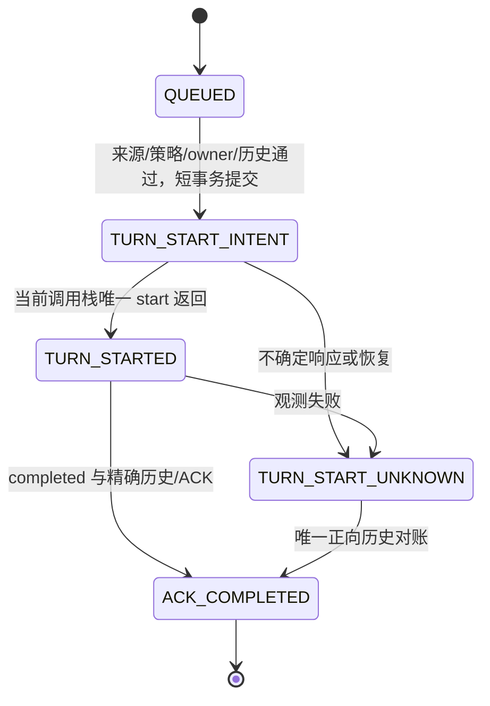

# M03-F1 — Bounded Persistent Codex Main ACK Runtime

日期：2026-10-29。实现范围：**离线有界 ACK 核心**；真实 App Server 阶段
`BLOCKED_TEST_AUTH`，整体 PARTIAL。详见[本轮验收报告](../milestones/M03-F1_DELIVERY_REPORT.md)。
本文件描述实际代码及限制，不替代 F0，也不宣称生产 Runtime 已验证。

## 1. 存储裁定与权限

用户明确选择 A：保留 F0 的 Project-owned Runtime sidecar。此裁定澄清本轮任务书
§2、§2.2、F1-05：队列、epoch、intent 和 ACK 在新 sidecar 内原子提交；
ResearchProject 仅提供已提交来源。没有跨库事务，没有修改旧 Project schema、
冻结合同、E1/D 库或其 reader。原先的存储冲突已解决，历史 F0 文档保持原样。

Codex 是唯一 Agent Harness；本模块没有推理循环、Agent SDK、DAG、daemon、
消息总线或 AF 执行端口。原七个 AF 读取工具和两个 proposal-only 工具均未改变。
Runtime 不写预算、候选、科研结论、Grant 或模型输入。可信测试 fixture 在初始化
前准备来源的写入，与 Runtime 运行时只读取科研状态，分开测试。

## 2. 三个新增生产模块

| 文件 | 实际责任 |
|---|---|
| `main_runtime_store.py` | 固定 sidecar、严格 schema、短 SQLite 事务、审计链、Windows 单发送者文件锁 |
| `main_runtime_rules.py` | 来源重建、F1 专用 policy、固定提示与 ACK schema、历史与状态转换检查 |
| `main_runtime.py` | 显式初始化、只读 status、有界两事件协调、唯一发送尝试、正向对账和有身份的空闲暂停/恢复 |

复用 E1 的 ContinuationEvent、可信 A 来源检查、基础身份/策略校验及 Project 路径、
文件身份和事务基础设施。不修改 E1；其 `max_turns=1` 策略不能授权 F1 两次事件。
F1 使用 `bounded-ack-policy-v1`，固定 `max_turns=2`、
`allowed_event=A_DECISION_THEN_CONTROL_STOP`、`native_goals_allowed=false`，最长一小时。

生产模块只有窄 port 调用：`preflight/history/start_turn/terminal`。
本轮没有完成可投入使用的真实 F1 App Server adapter；Fake port 是测试 double。
port 自报的能力字段必须由未来真实 adapter 的证据支持，不能视作已核验配置。

## 3. 来源与有界队列

当前 fixture 使用两个不同事务、相邻序列、相同 Workflow/合同的已提交事实：

1. Candidate A 的 `DECIDE`：`SYNTHETIC_DECISION_RECORDED`。
2. 紧随其后的 `BLOCK(reason=HUMAN_REVIEW_REQUIRED)`：`WORKFLOW_STOP_RECORDED`。

第二项引用第一项 event key，保留各自 source transaction、sequence、UTC、revision
和 digest。它是控制停止事实，**不是第二份科学 DecisionRecord，也不含新指标**。
这足以测试两个独立来源的交付和去重，但不满足任务书“两份已提交 Decisions”
的严格要求。因此 F1-03 为 LIMITED；没有为凑验收而执行 B 或扩展 Project schema。

初始化将两个来源及 source revision 同时写入 `INITIALIZED`。
队列固定两项，顺序与 cursor 由有序 journal 重放得出，没有通用 enqueue 或扫描器。
来源缺失、不相邻、不同合同、错误 STOP、非唯一 A、错误内容均拒绝。
初始化 revision 必须就是 STOP revision，不能将旧来源绑定到较新的当前 revision。

历史 status/reconcile 可以重建旧来源；新 dispatch 额外要求当前 Project revision
与初始化 revision 相等。冻结新版本合同后，旧 receipt 仍可读取或正向对账，
但后续事件不能发送。预检后源仍可能变化；短事务不保证远端发送时最新，ACK
只解释已提交快照，始终没有科研写权限。

## 4. 持久记录与事务

固定文件：`main-runtime-v1.sqlite3` 与零字节 `main-runtime-v1.owner`。
显式 O_EXCL 创建，记录文件身份；已有、替换、硬链接、污染锁文件和不完整创建
均不自动覆盖或修复。只读 status 不初始化存储。Windows 是当前支持平台。

唯一 SQLite 表：`events(sequence INTEGER PRIMARY KEY, body BLOB NOT NULL, digest TEXT NOT NULL)`。
每项规范 JSON 包含 schema、sequence、previous digest、唯一 transaction_id、UTC、kind
及 data。读取严格检查 schema、摘要链、序列和时间；限制 64 条、单条 64 KiB、库 4 MiB。
时间回退、额外 schema、残留 journal/WAL/SHM 等直接停止。达到上限不丢弃历史材料。
SHA-256/UTC 是一致性检测，不能抵御能同时重写文件和摘要的攻击者，也不是可信时钟或签名。

`INITIALIZED` 保存来源、policy、seed、operator、文件身份；`TURN_START_INTENT` 保存
event key、epoch、input digest、完整已接受历史基线、attempt_limit=1；
`TURN_STARTED` 保存响应 Turn ID；`ACK_COMPLETED` 保存标准化历史、匹配 Turn 与
观测类型；`CONTROL` 保存 operator、command ID、expected revision 和 pause 值。
观测 UTC 使用承载该 proof 的 journal UTC；历史是 read model，不是远端权威。

每次 SQLite 事务仅用于读取或一条审计提交；调用 port 前全部关闭。独立 BEGIN
IMMEDIATE 测试覆盖每个 port 方法，确认没有 Project/Runtime DB 长锁。
外部等待期间保留独立 OS sender mutex，它不是 SQLite 或仓库锁。此 mutex
保护协作进程的发送顺序，不是 App Server 认识的远端 fencing token。
当前 epoch 仅为每次 intent 的单调序号，不是持久进程 lease generation，不能证明
旧 owner 崩溃后的接管资格。

## 5. 状态、发送和恢复

第二项在第一项 ACK 完成前投影为 WAITING_PREDECESSOR。`run_bounded(max_events=2)`
是有限调用，没有后台轮询。相同完整事件重复投递不产生新的 port 调用；相同身份
但内容变造拒绝。两个独立进程竞争，只有持锁者可发送；另一方 OWNER_BUSY。

仅成功提交 intent 的原调用栈可尝试一次 start。重启后的 intent 投影 UNKNOWN，
已记录 TURN_STARTED 仍保留该名称但也禁止重发；二者都挡住后继。容量失败、丢回应、
错误 marker、server 退出或不完整历史均不退款、不改 key、不换线程、不自动重试。
本地和远端不共享事务，只保证最多一次有意发送尝试，不宣称远端 exactly-once。

ACK 检查 exact thread/Turn、唯一 Turn ID、seed/已接受历史前缀、输入摘要、
completed、零工具及 exact schema 输出。history 长度必须为 seed+当前已处理事件；
缺失/额外/重复/矛盾均阻断。已知 Turn ID 必须匹配；未知时仅唯一匹配可正向对账。
只读对账不会调用 start，不因策略到期而禁止读取旧结果；下一次发送仍受期限限制。
无效输出保留 UNKNOWN，当前未实现 F0 中更丰富的失败协议 disposition 分类。

## 6. 控制与所有权限制

`status()` 无科研或 Runtime 写入；显式 `control()` 具有 operator identity、
command ID 幂等和 revision CAS。operator ID 是受信调用边界校验，尚无登录认证 UI。
暂停/恢复只在取得 sender mutex 后提交。发送已在途时 control 返回 OWNER_BUSY，
**没有实现 F0 的“即时持久化暂停意图并列出在途发送”**；不声称完整 F0-13 PASS。

preflight 必须显式报告 native_goal=null、automatic_sources_disabled=true、
previous_owner_exited=true，并满足 E1 原配置/线程/idle 要求。离线负向测试拒绝
缺失、活动 Goal、未知 owner 或配置不符。它不能独立证明 OS 子进程退出；真正的
retained-process/孤儿进程处置、bootstrap/seed intent、分页 RPC adapter 仍未实现/验证。
禁止仅凭 OS 锁已释放、TTL 或旧 PID 不见而自动接管。

## 7. 当前 CLI 与原生 Goals 门槛

本机测量 CLI/App Server 为 `0.165.0-alpha.1.2`，本轮离线生成安装版本 schema。
`thread/start`、`thread/resume`、`thread/read`、`turn/start` 与完成通知分别核查；
接口存在不证明业务幂等、跨客户端排他或无工具策略已经生效。

[官方 Goals 文档](https://developers.openai.com/cookbook/examples/codex/using_goals_in_codex)
说明 Goal 属于线程，活动 Goal 可在空闲时驱动继续工作。因此它可能形成第二续回合
控制源。本机 `thread/goal/get` schema 可查询目标线程，但 response 的 goal 字段
可省略；未来必须要求显式 null，不能把缺字段当作无 Goal。

未来实测须在线程创建后且 seed 前、seed 后、恢复后、每次 start/intent 前和终态后
验证专用线程无 Goal；空线程若不能确认 goal=null，也须在 seed 前停止，
同时验证自动来源/队列配置；意外自动 continuation 或 queue 通知停止。
不调用 Goal set/clear/pause，不改变任何既有线程。当前仅完成静态检查和 Fake 负向
测试，**未进行真实 Goal 查询或证明自动来源全部禁用**。
[App Server 官方文档](https://learn.chatgpt.com/docs/app-server) 是接口参考；安装版本
schema 与实际能力证据控制上线判断。

## 8. 本轮真实预检与后续

仅执行一次专用新 HOME 的 `codex login status`，使用有界子进程、白名单环境和
私有目录；未复制凭据。返回 exit 1，认证未确认，标记 BLOCKED_TEST_AUTH。
stderr 原文未保存，不能断言具体失败原因。没有 App Server、thread/start、seed
或 turn/start。不能将历史 E1 成功或本轮 Fake 三项 history 当作真实 F1 成功。

当前实现适用于离线研究和审阅，不能部署为真实无人值守 Main。下一步先独立审定
两个来源的语义、专用认证/有效配置/无工具权限和生命周期方案；随后才能开发窄
adapter、bootstrap/seed 防重复和一次批准的三 Turn 实测。只读 status UI 可以另案
消费投影，但不得自行 resume、创建库或调用 port；本轮不实施下一阶段。
