# M03-A — Persistent fixed synthetic A/B workflow

Scope: `M03A_SYNTHETIC_WORKFLOW_PASS` is an offline qualification only. Codex remains
the sole Agent Harness. No AF Owner, authenticated discovery, Solver, ODB, MCP write
tool, SDK continuation or production execution port belongs to this implementation.

## G0 compatibility and authority decision

Starting point: local `main@6c549dc98c25a12dcb9c93baa4fbf8d629c80ec1`.
The pre-existing untracked M01-C review patch is preserved. Existing M02-A/B1/B2
contracts, source and reports define the reusable store, mutation and budget APIs.

There is no mandatory frozen-contract or SQL-table schema change. The four owned
tables and metadata schema 1 remain byte-compatible. Explicit writes append a new
`WORKFLOW_RECORDED` audit kind with `workflow-event-v1`; no open-time migration runs.
Project revision now orders freeze, budget and workflow writes. Candidate publication
still uses audit sequence without incrementing Project revision. The full replay
checks every revision, metadata digest, transaction/time stamp and prior event link.
Older binaries reject the unknown event kind and must not write such a Project.
This is an explicit versioned protocol extension, not forward compatibility.

Historical frozen Bundle/part bytes, IDs, hashes and earlier audit rows are not
rewritten. Existing journal/WAL/SHM rejection remains unchanged. Workflow cannot
delete a journal, force unlock, reset quota or infer an absent row means no effect.

## Minimal modules and data

- `research.workflow_rules`: typed definition/request/receipt/evidence, two narrow
  TEST port Protocols, deterministic verifier and pure audit reducer.
- `research.workflow`: explicit create, inspect and bounded advance calls, using
  existing ResearchProject transaction authority, Mutation Guard and BudgetLedger.
- `tests/fixtures/synthetic_workflow_port.py`: independent durable TEST fixture,
  outside product source. Its effect count is an independent oracle, not a result
  copied from the coordinator. It has no AF identity, Solver or process manager.

`WorkflowDefinition` binds a `workflow_` ID, exact BudgetScope (Project, Bundle/Goal
IDs/versions and four digests), a `syntheticport_` source, exactly two immutable
MutationRequest templates in A/B order, maximum steps 2, budget units 2, UNKNOWN=BLOCK.
Creation requires the current frozen Bundle, a two-slot Goal budget, at least two
allowed candidate proposals and an unused ledger. Only one workflow is admitted per
Project. Definition replay must match exactly; there is no reset or dynamic planner.

Each template predetermines candidate/stage/workspace identities, baseline digest,
scalar/units and mutation key. PREPARE binds its actual current Project revision;
it cannot change the frozen template's engineering content. Each candidate is
published/rechecked by the existing Mutation Guard. Baseline writes remain solely
trusted fixture preparation, never coordinator actions.

ExecutionBinding is the typed `SyntheticRequest`: workflow, A/B step, Project,
frozen refs, candidate ID/output digest, deterministic `syntheticattempt_` ID,
stable `fake_<workflow UUID>_A/B` business key and source ID. Its canonical digest
binds the reservation Plan label and submission intent. Every receipt embeds this
request; every evidence record embeds the receipt. Thus every returned record carries
`test_only=true`, `source_classification=SYNTHETIC_TEST_ONLY`,
`qualification=NOT_ABAQUS_QUALIFIED`, `physical_evidence_eligible=false`.

Receipt, evidence and attempt IDs have distinct synthetic prefixes, never AF `r_`,
owner or Grant identities. A changed source, request, digest, candidate, step, attempt,
receipt, entity, frame or unit cannot be used as evidence for the intended binding.
The test ports are trusted local infrastructure; typed records and hashes are not
authentication or an OS sandbox against arbitrary same-user code.

## Public API and durable boundaries

`create_workflow(explicit_write_project, definition, expected_revision)` records the
definition. `WorkflowCoordinator(project, workspace, workflow_id, execution_port,
evidence_port).inspect()` reconstructs committed state without writing or invoking
ports. Ports are optional for inspection. `advance(expected_revision)` requires a
write handle and explicit current revision. Each invocation advances a bounded
boundary; there is no internal scheduling loop, automatic retry or background task.

```mermaid
stateDiagram-v2
    READY_A --> PREPARED: persist predetermined A request
    PREPARED --> PREPARED: publish / reserve / record exact intent
    PREPARED --> CLAIMED: atomic claim, then one accept invocation
    CLAIMED --> ACCEPTANCE_UNKNOWN: original-key query unresolved; retain hold
    ACCEPTANCE_UNKNOWN --> OBSERVED: fresh matching original-key receipt
    CLAIMED --> OBSERVED: matching original-key receipt
    OBSERVED --> OBSERVED: charge existing reservation once
    OBSERVED --> READY_B: valid synthetic A miss; hard constraints pass
    READY_B --> PREPARED: persist predetermined B request
    OBSERVED --> SYNTHETIC_TARGET_MET: synthetic V3 met
    OBSERVED --> SYNTHETIC_TARGET_UNMET: B miss, two-step limit
    PREPARED --> BLOCKED: model/budget/contract refusal
    OBSERVED --> BLOCKED: invalid evidence/model or failed hard constraint
```

The snapshot includes current Project revision, workflow epoch, step/state, next
action, immutable definition, bound request/receipt, reservation identity/state,
decisions and explicit false real-world qualification flags. It does not obtain
credit from a historical BudgetLedger replay response. Budget availability comes
from current validated ledger state.
After a later contract freeze, inspection labels the preserved result
`HISTORICAL_WORKFLOW`; it is not a conclusion under the new frozen contract.

Reservation and exact submission intent commit before claim and before any synthetic
effect. The CLAIM reducer rechecks current Bundle, exact Candidate and reservation,
matching request/Plan digests, immutable key and SUBMISSION_INTENT_RECORDED state in
the same BEGIN IMMEDIATE transaction. A live independent mutation diff/file recheck
also runs inside that claim transaction. Only the caller whose new claim commits
may call `ExecutionPort.accept` once. Its response is deliberately not promoted to
evidence; a subsequent explicit advance must query the original request identity.

After claim, every other caller/reopened process is query-only, including when the
first caller crashed before calling the port. NOT_FOUND/None cannot justify a new
accept call: the original actor might still be in flight. This sacrifices liveness
to prevent duplicates. A new matching synthetic receipt can move UNKNOWN to OBSERVED
on an explicit advance; no new key, retry, time-based refund or negative acceptance
inference is used. Unresolved queries retain the full held unit.

An in-flight immutable claim can complete under its original contract even if another
actor freezes a new Bundle immediately afterward. The next advancement detects
CONTRACT_STALE and blocks; it cannot start B or promote old evidence under the new
criteria. Existing held/charged exposure remains; administrative settlement is not
implemented. Python file checks do not close malicious same-user replacement races.

## Verification and decisions

DECIDE requires a previously matched receipt and charged reservation, reads only
the original synthetic evidence identity and rechecks current candidate files again
inside the Project transaction. All required metric selectors must be present
exactly once; extra/missing metrics, malformed Decimal, changed units/frames and
failed test-protocol checks block. No unit conversion or missing-value inference.
Decimal comparisons use explicit sufficient precision rather than ambient rounding.

The deterministic verifier uses frozen Goal comparator/target/tolerance, every hard
constraint and the VerificationContract evidence requirements. It separately records
objective satisfaction and hard-constraint results. A hard-constraint failure is
HUMAN_REVIEW_REQUIRED, not a legitimate objective miss eligible for B.

V0 and V1 passes are explicitly synthetic. Test protocol integrity is distinct from
real V2, which remains NOT_RUN. V4 remains NOT_ASSESSED. Existing schema requires
V2=true in every contract; this is preserved. Missing real checks retain V2 and any
required V4. Synthetic continuation can be eligible while real-goal acceptance stays
INCONCLUSIVE/SIMULATED_ONLY. Neither a B target match nor an attached physical
reference silently discharges those requirements.

Each DecisionRecord contains deterministic ID, original Project revision, rule
version/digest, frozen refs, request/receipt/evidence references and evidence digest,
reservation and ALREADY_CHARGED_ONCE budget effect, reason and next state. Author is
DETERMINISTIC_GDCAE_SYNTHETIC_V1, never an LLM explanation. Audit replay recomputes
verification and decision from stored bounded evidence and frozen rules; it does
not trust a persisted PASS field. SHA-256 is a consistency check, not a signature.

## Stops and failure limits

MODEL_REJECTED, BUDGET_BLOCKED, EVIDENCE_INCONCLUSIVE, CONTRACT_STALE and
HUMAN_REVIEW_REQUIRED are persisted terminal BLOCKED reasons. ACCEPTANCE_UNKNOWN
is a durable held, query-only state. Journal detection returns a non-persisted
JOURNAL_BLOCKED observation because writing a blocked store would violate policy.
Revision races reject or return journal blocking; they cannot claim another effect.

Before/after reservation, intent, claim/effect, evidence, decision and B admission
are independently testable fault boundaries. A failed workflow transaction leaves
old/committed state or an explicit journal block. A committed claim with no fake
effect may remain UNKNOWN indefinitely. Filesystem publication and SQLite are not
one atomic resource. There is no power-loss, universal crash-recovery, distributed
exactly-once or adversarial-host guarantee. Existing 1024-event/64-MiB bounds remain.

M01 AF bridge, DTOs, MCP seven tools and roles remain unchanged and are never used
to disguise synthetic data as authenticated IPC. M03-B live AF TEST_ONLY integration
requires its own capability/source review and separate approval; it is not implemented.
