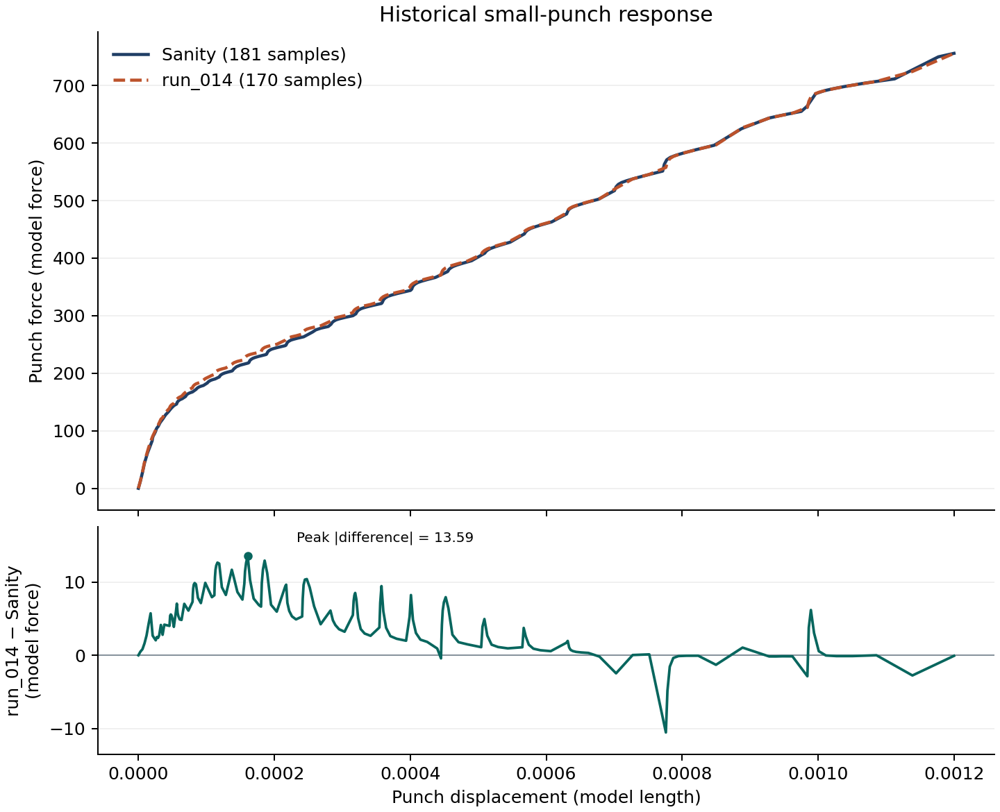

# SP-InvOpt / Sanity 与 run_014

**末点力接近，仍不足以接受新材料表。** 位移和力分别按 d = −U2、F = −RF2 取向。上图显示公开历史 ODB 提取曲线，下图显示在相同位移下 run_014 减 Sanity 的力差。

| 指标 | 复算值 |
|---|---:|
| 末点力差（模型力） | −0.07781982 |
| 末点相对差（以 Sanity 末力为分母） | −0.01029509% |
| 全曲线等采样点权重 RMS 差（模型力） | 6.13378623 |
| 最大绝对差（模型力） | 13.59220167 |
| 最大差所在行程 | 13.40% |

比较使用 Sanity 的 181 点和 run_014 的 170 点，将历史力线性插值到后者的 170 个位移上，仅在共同覆盖范围内取值。归档 CSV 的力与位移使用模型单位，物理单位仍待核验。两份输入均使用 Q200N01 材料。塑性表由 1251 行变为 35 行。忽略注释并统一换行后，塑性数据块以外的求解卡片一致，包括弹性、网格、夹持、加载、接触与输出设置。

这是两次历史有限元响应的比较。run_014 的历史执行带有警告。本次使用既有 ODB 提取 CSV，未重新提取 ODB 或运行 Solver。Sanity 的公开提取记录可查，完整历史 INP 到 ODB 的私有来源链未复核。该比较没有独立实验接受阈值，材料的物理有效性尚未确立。建议预注册沿 σ_y、n 局部弱方向的正负两点验证，在数值分辨率允许的范围内比较分段与全曲线响应。执行须另行授权。

**复算**　使用已确认的 Python 3 解释器运行同目录的 `recompute.py`。程序读取 `Sanity.csv` 与 `run_014.csv`，逐点核对 `difference.csv` 并输出上述指标。两份曲线的公开项目相对路径和 SHA256 见 `rc3-evidence.json`。该目录供查看和复算，插件的模型身份检查另需完整、获准访问的外部 SP 项目。
